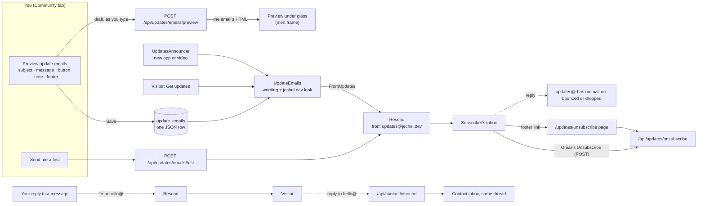
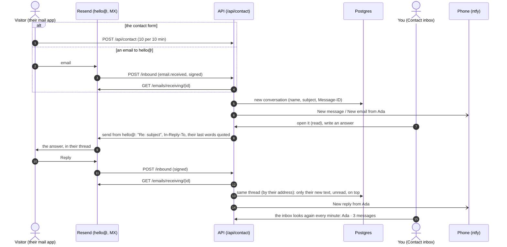
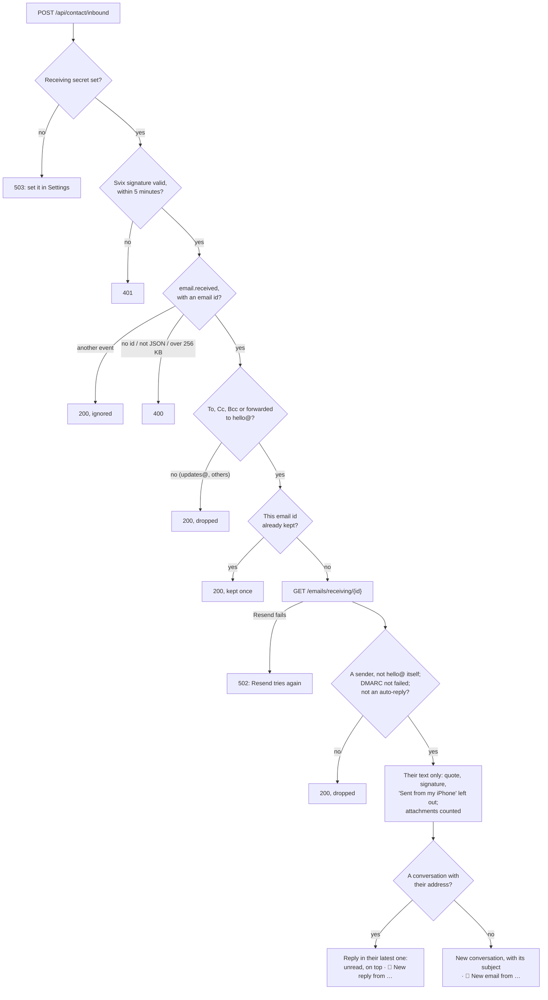
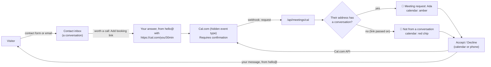
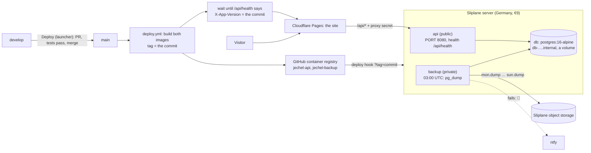

# jechel.dev.2026

Personal portfolio website of Claudiu Mihai Jechel.

| Layer    | Stack                                                           |
| -------- | --------------------------------------------------------------- |
| Frontend | React 19 + Vite 8 + TypeScript (`frontend/`)                    |
| Backend  | .NET 10 minimal API + EF Core 10 + Npgsql (`backend/`)          |
| Database | PostgreSQL 16 (Docker Compose for local dev)                    |
| Hosting  | Cloudflare Pages (site + `/api` proxy), Sliplane in Germany (API + PostgreSQL + backups) |
| State    | Redux Toolkit + RTK Query; views in MVVM (View + `*.viewModel.ts`) |
| Tests    | Backend: xUnit, Testcontainers. Frontend: Vitest in headless Chromium (coverage, screenshots) |
| CI       | GitHub Actions (`.github/workflows/ci.yml`)                     |

## Repository layout

```
.
├── backend/
│   ├── Portfolio.slnx                     # solution
│   ├── global.json                        # pins .NET SDK 10.0.x
│   ├── src/Portfolio.Api/
│   │   ├── Program.cs                     # composition root (DI, middleware, endpoint mapping)
│   │   ├── Data/                          # DbContext, entities, EF migrations
│   │   └── Features/<Feature>/            # endpoints grouped by feature
│   └── tests/
│       ├── Portfolio.Api.UnitTests/       # fast tests, no external dependencies
│       └── Portfolio.Api.IntegrationTests/# real HTTP pipeline + real PostgreSQL (Testcontainers)
├── frontend/
│   ├── functions/api/[[path]].ts          # Cloudflare Pages Function: the site's /api proxy to the API on Sliplane (production)
│   ├── src/
│   │   ├── services/api.ts                # the single API service: every backend call goes through `api`
│   │   ├── services/endpoints/<feature>.ts # each feature's endpoints and types (put together by api.ts)
│   │   ├── services/http.ts               # the plumbing under them: axios, ApiError, the preview switch
│   │   ├── store/                         # the Model: Redux store, slices, RTK Query endpoints (store/api/)
│   │   ├── auth/                          # useAuth, useSessionKeeper, <SignedIn>/<SignedOut> (state in store/authSlice)
│   │   ├── layout/                        # site frame: greeting, session bar, section tabs
│   │   ├── pages/                         # one folder per route: X/X.tsx + X/X.viewModel.ts
│   │   ├── features/<feature>/            # a feature's components and rules (e.g. contact form + inbox)
│   │   └── components/                    # shared UI: Modal, CopyButton, icons
├── backend/Dockerfile                    # the API's production image (built by deploy.yml, run on Sliplane)
├── backend/db-backup/                    # the nightly database backup's image (pg_dump to object storage)
├── scripts/dev_launcher.py                # GUI launcher for common dev tasks (macOS)
├── scripts/deploy.sh                      # deploy: pull request develop → main, merged when CI passes
├── scripts/build_brand_j.py               # draws the "j": the Vice title's first letter and the tab icon
├── docker-compose.yml                     # local PostgreSQL
└── .github/workflows/ci.yml
```

## Prerequisites

- .NET 10 SDK (`dotnet --list-sdks`)
- `dotnet-ef` global tool, for migrations (`dotnet tool install -g dotnet-ef`)
- Node.js 24+
- Docker Desktop, for the local database and the backend integration tests
- Python 3 with Tk, only for the dev launcher (`brew install python-tk@3.14`)

## Ports and URLs

| What        | URL                        | Notes                                                |
| ----------- | -------------------------- | ---------------------------------------------------- |
| Frontend    | http://localhost:5173      | Vite dev server (`strictPort`, fails if taken). Proxies `/api/*` to the API |
| API         | http://localhost:5105      | `http` launch profile. Browse the site via 5173, not 5105 |
| PostgreSQL  | localhost:**5433**         | 5433, not 5432, so it doesn't clash with a Homebrew Postgres |
| Redis       | localhost:**6380**         | 6380, not 6379, for the same reason. Optional: the API caches in memory without it |
| OpenAPI doc | http://localhost:5105/openapi/v1.json | Development only                        |

Local DB credentials (dev only): database/user/password all `portfolio`.

## Running locally

```bash
# 1. Database (and Redis, the API's optional cache)
docker compose up -d --wait

# 2. API (applies EF migrations + seed data on startup in Development)
dotnet run --project backend/src/Portfolio.Api --launch-profile http

# 3. Frontend
cd frontend && npm install && npm run dev
```

### Dev launcher (macOS)

```bash
python3 scripts/dev_launcher.py
```

A small window with buttons. Each opens a new Terminal window running the matching commands from the repo root; stop with Ctrl+C.

| Button             | Runs                                                              |
| ------------------ | ----------------------------------------------------------------- |
| Start backend      | `docker compose up -d --wait`, then the API                       |
| Start frontend     | `npm run dev`                                                     |
| Start website      | Both of the above in two windows. The frontend waits until `/api/health` responds, then opens the site in the browser |
| Open repo map      | `npm start` in `tools/repomap` (runs `npm install` the first time): builds the 3D architecture map, opens it in the browser and rebuilds it on every change. See [tools/repomap/README.md](tools/repomap/README.md) |
| Run backend tests  | `backend/test.sh` (all tests, with coverage), then opens the coverage report in the browser |
| Run frontend tests | `npm test` in `frontend` (all tests, with coverage), then opens the coverage report in the browser |
| Run all tests      | Both of the above, one after the other, then both coverage reports |
| Deploy to production | `scripts/deploy.sh`: only enabled on `develop`. See [Deployment](#deployment) |

The first click may trigger a macOS prompt to allow Terminal automation; allow it.

## API conventions

- **Every endpoint lives under `/api`** (`app.MapGroup("/api")` in `Program.cs`). Feature endpoint files map *relative* routes onto that group.
- The frontend always calls relative `/api/...` URLs, through `src/services/api.ts` (see [Frontend conventions](#frontend-api-service-and-auth-state)). In dev the Vite proxy forwards them to the API, so browser, cookies and API share one origin (no CORS). Production should do the same: serve the SPA and route `/api` to the API on one domain.
- The Vite proxy sends `X-Forwarded-Host/Proto` (`xfwd: true`) and the API runs `UseForwardedHeaders()`, so URLs the API generates use `localhost:5173`, the origin the browser sees. By default only loopback proxies are trusted; configure `KnownProxies`/`KnownNetworks` when deploying behind a real proxy.

| Method | Route                       | Auth    | Description                                        |
| ------ | --------------------------- | ------- | -------------------------------------------------- |
| GET    | `/api/health`               | public  | `Healthy` when the API can reach the database (used by the launcher) |
| GET    | `/api/firstname`            | public  | `{ "firstName": "Claudiu" }` from the database      |
| GET    | `/api/auth/login?returnUrl=`| public  | Browser navigation: redirects to Google sign-in    |
| GET    | `/api/auth/signin-google`   | public  | OAuth callback, handled by ASP.NET Core; don't call directly |
| GET    | `/api/auth/me`              | cookie  | Current user `{ email, name, pictureUrl, sessionExpiresInSeconds }`, or **401** |
| POST   | `/api/auth/logout`          | public  | Clears the cookie; when signed in, also ends the session everywhere |
| POST   | `/api/contact`              | public  | Contact form `{ name, email, message }`: **201**, or **400** with field errors (`ValidationProblem`) |
| GET    | `/api/contact/messages?page=&pageSize=` | cookie | Inbox page, newest first: `{ items: [{ id, name, receivedAt, isRead }], page, pageSize, totalCount }` (pageSize 1–50, default 10) |
| GET    | `/api/contact/messages/{id}` | cookie | One message `{ id, name, email, message, receivedAt, readAt }`, or **404**. Doesn't mark it read |
| POST   | `/api/contact/messages/{id}/read` | cookie | Marks it read (keeps the first read time): **204**, or **404** |
| GET    | `/api/about`                | public  | The About Me page (photo, links, skills, experience, education, papers, qualifications); placeholders until the first save |
| PUT    | `/api/about`                | cookie  | Replaces the whole page: **200** with it as stored (trimmed, lists in the order sent), or **400** with field errors keyed by path (`experience[0].title`) |
| GET    | `/api/terms`                | public  | The terms and conditions `{ title, intro, sections: [{ heading, blocks: [{ kind: paragraph\|bullets, text, items }] }], updatedAt }`; defaults with `updatedAt: null` until the first save |
| PUT    | `/api/terms`                | cookie  | Replaces the terms: **200** with them as stored (trimmed, new `updatedAt`), or **400** with field errors keyed by path (`sections[0].blocks[1].items[2]`) |
| POST   | `/api/analytics/events`     | public  | A batch of a visit's events `{ sessionId, session, events }`: always **204** (the admin, bots and repeats aren't stored), **400** without `sessionId` |
| GET    | `/api/analytics/summary?range=` | cookie | Totals, the chart's columns (`series`, sized by `bucketSize`) and top-10 lists for `range`: `1h`, `24h`, `7d`, `30d` (default), `90d`, `1y`, `5y` or `all` |
| GET    | `/api/analytics/sessions?page=&pageSize=&errorsOnly=` | cookie | Visits, newest first (pageSize 1–50, default 20) |
| GET    | `/api/analytics/sessions/{id}` | cookie | One visit with every event in order, or **404** |
| DELETE | `/api/analytics/sessions/{id}` | cookie | Deletes the visit and its events: **204**, or **404** |
| GET    | `/api/support`              | public  | `{ url }`: where the header's **Buy me a coffee** goes (`Support:Url`); `""` hides it |
| POST   | `/api/support/buymeacoffee` | signature | Buy Me a Coffee's webhook (HMAC-SHA256 of the body in `X-Signature-Sha256` or `X-Bmc-Signature`): stores the payment once, alerts the phone. **401** for a bad signature, **503** until the webhook secret is set |
| GET    | `/api/support/donations?page=&pageSize=` | cookie | Donations, newest first |
| POST   | `/api/updates/subscribe`    | public  | `{ email }`: **200** `{ status }`: `sent` (a confirmation link is on its way), `alreadySubscribed`, or `pending` (one went out less than 10 minutes ago). **400** field error, **429** after 5 tries per IP in 10 minutes, **503** when the email couldn't be sent (and the phone is told why) |
| POST   | `/api/updates/confirm?token=` | public | Confirms: **200** `{ email }`, or **404** |
| POST   | `/api/updates/unsubscribe?token=` | public | Deletes the subscriber: always **204** (also what mail apps' one-click Unsubscribe posts) |
| GET    | `/api/updates/subscribers?page=&pageSize=` | cookie | Subscribers, newest first, with `confirmedAt` |
| DELETE | `/api/updates/subscribers/{id}` | cookie | **204**, or **404** |
| GET    | `/api/updates/announcements?page=&pageSize=` | cookie | Update emails, newest first, with their `status` (`pending`, `approved`, `sent`, `ignored`) |
| POST   | `/api/updates/announcements/{id}/send?token=` | cookie or token | Approves a pending one (emailed at once): **200** `{ status }`. The phone alert's button sends the token |
| POST   | `/api/updates/announcements/{id}/ignore?token=` | cookie or token | Ignores a pending one |
| GET    | `/api/resume?inline=`       | public  | The last generated résumé **without** the phone number (PDF), or **404** |
| GET    | `/api/resume/private?inline=` | cookie | The same **with** the phone number |
| GET    | `/api/resume/headline`      | public  | `{ headline }`: shown under the name on About Me (`""` until set); never the phone or email. `no-cache` |
| GET    | `/api/resume/settings`      | cookie  | `{ phone, email, headline, sections, excludedSkills, generatedAt }` |
| PUT    | `/api/resume/contact`       | cookie  | `{ phone, email, headline }` (edited with About Me's profile): **200**, or **400** with field errors |
| PUT    | `/api/resume/choices`       | cookie  | `{ sections, excludedSkills }` without generating: **200**, or **400** |
| POST   | `/api/resume/generate`      | cookie  | `{ sections, excludedSkills }`: saves them, makes both PDFs, and points About Me's résumé link at the public one: **200**, or **400** |
| GET    | `/api/meetings/info`        | cookie  | `{ bookingUrl }`: the Cal.com booking page to send in an answer (**Add booking link**), or `""` |
| POST   | `/api/meetings/cal`         | signature | Cal.com's webhook (HMAC-SHA256 of the body, hex, in `x-cal-signature-256`): keeps bookings up to date, alerts the phone. **401** bad signature, **503** until the secret is set |
| GET    | `/api/meetings?from=&to=`   | cookie  | Meetings overlapping the range (a calendar month), soonest first |
| POST   | `/api/meetings/{id}/accept` | cookie or token | `{ message? }`: confirms a requested meeting with Cal.com and emails the message: **200** `{ status, emailSent }`, **502** when Cal.com refuses |
| POST   | `/api/meetings/{id}/decline` | cookie or token | The same, declining (the message is also Cal.com's reason) |
| POST   | `/api/contact/messages/{id}/reply` | cookie | `{ text }`: emails the answer to the sender from the site's address (hello@), in their email's thread, with what they last wrote quoted: **200**, **400**, **503** when it can't be sent |
| POST   | `/api/contact/inbound`      | Resend's signature | Resend's `email.received` webhook: an email to the site's address joins the sender's latest conversation, or starts one: **200**, **400**, **401**, **502** (Resend tries again), **503** until its secret is set |
| GET    | `/api/site`                 | public  | What visitors see: `{ pages, features, maintenance, maintenanceMessage }` (cached: memory, then Redis) |
| PUT    | `/api/site`                 | cookie  | Changes what's given (pages, features, maintenance, its message): **200**, or **400** for unknown ids |
| GET    | `/api/settings`             | cookie  | The connection settings (secrets only as set/not set and their last 4 characters), how Google sign-in is set up, and the site's address |
| PUT    | `/api/settings/{key}`       | cookie  | `{ value }`: saves one (encrypted if secret) and applies it at once; `""` clears it. **400** for a bad value, **404** for an unknown key |
| POST   | `/api/settings/test/{service}` | cookie | `ntfy` (test alert), `email` (test email to you) or `youtube` (lists the videos): **200** `{ ok, message }` |
| POST   | `/api/youtube/refresh` | cookie | Asks YouTube for the videos now and keeps them: **200** `{ count }`, **503** when YouTube isn't set up or can't be reached |

## The "j" (Vice title and tab icon)

Mr Dafoe's own j has a long, thin tail loop that closes up when small (in a browser tab it looked like a
banana), so the site draws its own: `scripts/build_brand_j.py` traces a brush stroke (thick going down,
thin going up, with a wide, open loop) in the font's units and writes two weights of it:

- `frontend/src/assets/brand-j.svg`: the Vice title's j. `glass.css` (`.brand-j::before`) masks the neon gradient and the purple shadow layer with it, where the font's j would be; the letter stays in the page (at size 0) and the title link is named "jechel.dev", so screen readers still read the name. Other themes show the plain j.
- `frontend/public/favicon.svg`: the tab icon, a bolder j on a dark tile. `favicon.ico` (16, 32, 48 px, for Safari and old browsers) and `apple-touch-icon.png` (180 px) are renders of it.

After changing the drawing, re-run the script, re-render the PNG copies (e.g. a Playwright screenshot of
favicon.svg), update the bounds in `.brand-j::before` if the script prints new ones, and bump the `?v=`
on the icon links in `index.html` (browsers keep tab icons cached).

## Terms and conditions

```
  The terms (GET /api/terms)
     saved by the admin in the Terms tab ──▶ terms_page (title, intro, sections), dated when saved
     never saved ─────────────────────────▶ TermsDefaults (dated TermsDefaults.UpdatedAt: move it when they change)
          │
          ▼  their date is the version a visitor accepts
  A visitor opens any page (not /admin)
     this browser accepted that version? (localStorage "terms.accepted")
        yes ──▶ the site; visits are recorded (AnalyticsTracker: "on")
        no  ──▶ the welcome popup (TermsGate): one box, Continue
                   the terms can be read above it (TermsDialog)
                   nothing is recorded meanwhile ("waiting"; a visitor who never accepts is never sent)
                   Continue ──▶ the version is remembered ──▶ the site; recording starts
  The signed-in admin: never asked, never recorded.

  Anywhere: the footer's "Terms and Conditions" opens TermsDialog (× / Escape / a click outside close it;
  a link in them to a page of the site goes there and closes it).
  Locally (npm run dev, not signed in): the User bar's "Reset terms acceptance" forgets it and reloads.
```

- **Welcome popup:** a visitor who hasn't accepted the terms (anywhere but the sign-in page, `/admin`) gets a popup that can't be closed: one box, "I have read and I accept the Terms and Conditions of this website", then **Continue**. Everything else is in the terms themselves. Accepting is remembered in the browser (`localStorage["terms.accepted"]`) against the terms' date (`updatedAt`), so new terms ask everyone again. The signed-in admin isn't asked.
- **The default terms** (`backend/.../Features/Terms/TermsContent.cs`, `TermsDefaults`) are shown until the admin saves terms in the Terms tab. They describe, from the code, what the site records and keeps, who handles it and visitors' rights (UK GDPR), and point to the Contact page for requests. They have their own date (`TermsDefaults.UpdatedAt`): **move it whenever their text changes**, so visitors are asked again. Tests check they still name every browser-storage key and outside service (`TermsEndpointsTests`); add to both when the site starts keeping something new. They're a starting point, not legal advice.
- **Reading them:** the footer on every page, and the welcome popup, have a **Terms and Conditions** link that opens them in a popup above anything else that's open. It closes with **×** at the top (or Escape, or a click outside).
- **Seeing the welcome popup again** (to try it): run the site locally (`npm run dev`), not signed in. A **User** bar sits above
  the header (`layout/UserBar`), the visitor's counterpart of the Admin bar, with **Reset terms acceptance**: it forgets this
  browser's acceptance and reloads the page. It shows only in Vite's `development` mode: never on the live site, and not in
  tests unless one switches it on (`vi.stubEnv('MODE', 'development')`).
- **Editing them:** the admin's last tab, **Terms**, shows them as a page with an **Edit** button: title, introduction, and numbered sections of paragraphs and bullet lists (add, reorder, remove). Text may contain `[text](https://…)` links.

## Engagement (visitor analytics)

The site records how it's used itself: no third parties, no cookies. The admin reads it in the **Engagement** tab.

**Recording** (`src/features/analytics/tracker.ts`, mounted by `<AnalyticsTracker>` in `App/App.tsx`):

- **What:** pages opened (with the query); clicks on buttons, links and fields (the label the visitor saw, plus a link's address; **never what was typed**), and clicks into embedded players (YouTube: the window loses focus to the frame); fields changed (`change`: a list's option, a slider's value, how many files; a text field only that it was edited); forms sent (`submit`, with Enter or a button); Escape; copying text (not what); videos played, paused and finished; how far down each page was read (`scroll`, in quarters, recorded on leaving the page); the tab hidden and back (`tab`); leaving (`leave`); the site's own events (`trackEvent`: Terms accepted, Message sent / not sent and why, Contact form invalid with the field names, Subscribed / again / failed and why, Subscription confirmed, Unsubscribed, Support clicked, Swiped to another slide, Moved to another slide with the keyboard, Zoomed / Moved the map, Looked at a place on the map, Theme changed); and every **error**: script errors with file, line and stack, unhandled promise rejections, React crashes with the component stack (`createRoot` callbacks in `main.tsx`), requests that fail with 5xx or no answer (`onRequestFailed` in `api.ts`; 4xx answers are expected and skipped), and images or files that didn't load.
- **A visit** is a browser tab: a random id in `sessionStorage`, so it survives reloads and ends with the tab. It starts with the page, the referring site (host and path; no query), `utm_*` tags, language, time zone, screen and window size, and theme.
- **Theme:** a visit keeps the theme it started in (Vice for first-time visitors, their earlier choice for those coming back) and the one it ended in: every batch says the theme on show, and the last is sent as the tab closes. Each switch is a `Theme changed` event with `from` and `to`.
- **Who isn't recorded:** visitors who haven't accepted the terms (the tracker is off: nothing is kept for later; once they accept, the visit starts with the page on show and `Terms accepted`), the signed-in admin (the tracker waits for the sign-in check, and the API ignores requests with the admin cookie), and bots and headless browsers (by User-Agent, which includes the Playwright runs).
- **Sending:** batches every 5 seconds, and `sendBeacon` when the tab is hidden or closed. Limits: 1,000 events per page load, the same error 5 times, and the API stops a visit at 2,000.
- **Unique visitors without cookies:** the API hashes IP + User-Agent with a random salt that changes every UTC day and is never stored (`VisitorHasher`), like Plausible. The same person counts once a day, can't be followed across days, and no IP is stored. A restart picks a new salt, so someone may count twice that day.

**Storage:** `visit_sessions` (one row per visit, with counters) and `visit_events` (one row per event, `detail` as `jsonb`; unique on visit + sequence number, so a batch sent twice is stored once). Deleting a visit deletes its events, and `AnalyticsRetention` deletes visits after 12 months.

```
 Visitor's browser                                                       API                          Admin
 ─────────────────                                                       ───                          ─────
 Welcome popup ── not accepted ──► tracker OFF (nothing recorded or kept)
       │ accepted (Terms accepted)
       ▼
 tracker ON ◄── <AnalyticsTracker>: pages opened, theme switches, signed-in? (admin ⇒ OFF)
   │ listens: click · change · submit · Escape · copy · play/pause/ended · scroll depth
   │          · tab hidden/back · leave · frame focus (YouTube) · errors · failed requests
   │ trackEvent(): Message sent · Subscribed · Swiped · Zoomed the map · …
   ▼
 queue ──every 5 s──► POST /api/analytics/events ──► Collect: skip admin & bots, dedupe by seq,
   └──tab hidden/closed──► sendBeacon (15 a piece)       date by age, hash IP+UA (daily salt),
                                                         country (CF-IPCountry) ──► visit_sessions
                                                         errors ──► phone alert (throttled)  visit_events
                                                                                    │
 Engagement tab ◄── GET /api/analytics/summary?range= ◄── counters, chart, top lists ┤ (admin only)
   visits table ◄── GET /api/analytics/sessions?errorsOnly= ◄───────────────────────┤
   a visit ◄────── GET /api/analytics/sessions/{id} (timeline, Copy steps) ◄────────┘
                   DELETE …/{id}            AnalyticsRetention: deletes visits after 12 months
```

**The tab** (`src/pages/EngagementPage/EngagementPage.tsx`, `src/features/analytics/`): a period of 1 hour, 1 day, 7 / 30 / 90 days, 1 year, 5 years or all time, with
- counters: visitors, visits, page views, average visit, bounce rate (one page and nothing done on purpose: clicks, keys, changes, forms and site events count; scrolling, the tab and leaving don't; `AnalyticsRules.InteractionTypes`), errors
- visitors, page views or errors as a column chart, one column per 5 minutes (1 hour), hour (1 day), day (7 to 90 days), month (1 and 5 years; all time) or year (all time beyond 6 years). Columns are aligned in UTC (`AnalyticsRange.cs`); "1 hour" and "1 day" are rolling. Visits count when they started, page views and errors when they happened. Hover a column for its number; a hidden table gives screen readers the same
- top pages, where visitors come from, most clicked, **what visitors did** (the site's events, theme changes aside), errors, **preferred theme** (the one visits ended in), **theme switches** ("vice → dark"), devices, browsers, **countries** (Cloudflare's, by name), time zones
- **Refresh** loads the numbers and the visits again, and a visit seen before is asked for again when it's next opened (it may still be going on)
- every visit (optionally only those with errors). One opens its timeline: what it ran on, then each step with its time, errors with their stack. **Copy steps to reproduce** gives it all as text, for an issue or an AI. Visits can be deleted.

Summaries are worked out in memory from the period's rows: plenty for a personal site; move the grouping into SQL if traffic grows a lot.

**Privacy:** nothing is recorded until the visitor has accepted the terms (`AnalyticsTracker` keeps the tracker off, so
not even clicks under the welcome popup are sent later), and the terms say exactly what's recorded: a backend test
(`The_default_terms_say_what_is_recorded`) fails when a kind of event is added without a line in the terms. Visits are deleted 12 months after they were last
seen (`AnalyticsRetention`, daily; `TermsDefaults.VisitRetentionMonths`). IP addresses aren't stored (`VisitorHasher`).

## Authentication (Google, admin only)

Only the site owner signs in, to reach the admin parts of the site. There are no public accounts.

```
 You, on /admin             API (jechel.dev/api, through the Cloudflare proxy)              Google
 ──────────────             ──────────────────────────────────────────────                  ──────
 "Sign in with Google" ───▶ GET /api/auth/login?returnUrl=/
                            correlation cookie + state, PKCE; redirect ─────────────────────▶ choose account
                            GET /api/auth/signin-google?code=… ◀───────────────────────────── redirect back
                            1. correlation cookie and state checked (no forged sign-ins)
                            2. code swapped for the profile, server to server (no token reaches the browser)
                            3. GoogleSignIn: email verified, on Auth:AdminEmails (and Auth:AdminGoogleIds, if set)?
                                 no  → /admin?error=not_authorized, no cookie, phone alert "Sign-in refused"
                                 yes → a session for this device (admin_sessions: the token's hash, device, IP,
                                       country), cookie __Host-portfolio.auth with the token, phone alert
                                       "Signed in to jechel.dev"
 signed in ◀─────────────── redirect to returnUrl (local paths only)

 every later request with the cookie: token hash looked up → not expired, not past 12 hours, email still allowed?
   yes → the request is the admin's (expiry pushed to now + 10 min, at most once a minute, never past 12 hours)
   no  → a visitor's (the cookie is cleared; an account taken off the list loses its sessions for good)
```

**Flow**: the visitor opens `/admin` and clicks **Sign in with Google**, a plain link to `/api/auth/login?returnUrl=/`. The API
redirects to Google (authorization code flow with PKCE, a `state` parameter and a correlation cookie), Google redirects back to
`/api/auth/signin-google`, ASP.NET Core swaps the code for the profile, and `GoogleSignIn.OnTicketReceivedAsync` decides:

- **allowed** (the email is verified by Google, is in `Auth:AdminEmails`, and, if `Auth:AdminGoogleIds` is set, the account's
  permanent Google id is in it): a new session for this device, the cookie, a phone alert, and a redirect to `returnUrl`
- **anyone else**: no cookie, a redirect to `/admin?error=not_authorized`, and a phone alert (throttled per email)
- **cancelled or failed on Google** (or a callback without this browser's correlation cookie): `/admin?error=login_failed`

The frontend (`useSessionKeeper`, into the store's `auth` slice) calls `/api/auth/me` on load. Signed in, the admin bar shows
"Signed in as ... · Sign out", and the admin's tabs and editing appear.

### Sessions (one per device, in the database)

Each device signed in has its own row in `admin_sessions` (`AdminSessionService`): the SHA-256 of a random 256-bit token (the
encrypted cookie carries the token itself), the email, when it signed in and was last active, its idle expiry and its absolute
end, the browser (User-Agent), IP address and country.

- **Idle timeout, 10 minutes** (`Auth:SessionIdleTimeout`). Any request is activity: at most once a minute, the expiry moves to
  now + 10 minutes and the cookie is re-issued.
- **Absolute limit, 12 hours** (`Auth:SessionMaxLifetime`): however active, a session ends 12 hours after signing in; then it's
  Google again. Activity never pushes the expiry past it.
- **Sign out** (the admin bar) ends this device's session. **Settings → Signed-in devices** lists every device (this one marked)
  with its address, country and times, and signs one out (`DELETE /api/auth/sessions/{id}`) or all the others
  (`POST /api/auth/sessions/end-others`). Anonymous calls to `/api/auth/logout` only clear their own cookie.
- **Other tabs**: signing out in one tab signs this browser's other tabs out at once, and signing in makes them check
  (`auth/authChannel.ts`, a BroadcastChannel). Activity in one tab keeps them all going (they share the cookie).
- **Taken off the list**: removing an email from `Auth:AdminEmails` (or its id from `Auth:AdminGoogleIds`) ends its sessions on
  their next request, for good.
- Ended sessions are cleared out of the table whenever someone signs in.
- **No answer isn't "signed out":** only the API's answer decides (signed in, or 401). If the first check gets no answer (the API
  down or restarting, a network error, a 5xx), the page keeps waiting and asks again (after 2, 4, 8, then every 15 seconds), so
  restarting the API doesn't sign the admin out of an open page.
- **Frontend** (`src/auth/useSessionKeeper.ts`): while signed in, clicks, key presses, scrolling and mouse movement call
  `/api/auth/me` (at most once a minute) to keep the session alive. A timer re-checks just after `sessionExpiresInSeconds`, so the
  UI shows you as signed out once the session ends. The expiry is sent as *seconds remaining*, not a timestamp, so the browser's
  clock doesn't matter.

### Protections

- **The cookie**: `__Host-portfolio.auth` in production (browsers keep it only if it's Secure, for the whole site, and for
  exactly this host: a subdomain can't set or overwrite it), HttpOnly (scripts can't read it), SameSite=Lax. Locally
  `portfolio.auth`, over http.
- **Cross-site writes** (`SameOriginWrites`): a POST, PUT, PATCH or DELETE carrying the cookie must come from the site itself
  (its `Origin` header); otherwise **403**. A second guard after SameSite. Requests without the cookie (visitors, webhooks) aren't
  checked.
- **The keys** that encrypt the cookie and the Settings secrets (ASP.NET Core Data Protection) are kept in the database
  (`data_protection_keys`), and encrypted there with AES-256-GCM when `DataProtection:KeyEncryptionKey` is set (production;
  `KeyRingEncryption.cs`). Locally they're stored as they are.
- **Headers**: the site's pages (`frontend/public/_headers`, Cloudflare Pages) get a Content-Security-Policy (only the site's own
  scripts run; only YouTube can be framed; the site can't be framed), HSTS, a Permissions-Policy
  (no camera, microphone or location), `nosniff` and a Referrer-Policy. The API's own responses get `nosniff`,
  `X-Frame-Options: DENY` and the Referrer-Policy.
- `returnUrl` must be a local path (`/...`); anything else falls back to `/` (no open redirects).
- API calls without a valid cookie get a plain **401** (or **403**), never a redirect to a login page. To protect a new endpoint,
  add `.RequireAuthorization()`.
- If Google credentials aren't configured, the API still runs and `/api/auth/login` returns **503**.
- **Your Google account is the gate**: give it 2-step verification or a passkey.

### Setting up Google sign-in

1. In [Google Cloud Console](https://console.cloud.google.com/), create (or pick) a project.
2. **Google Auth Platform → Branding** (or "OAuth consent screen"): app name, support email, developer contact. Audience **External**. While in *Testing*, add your Google account under **Audience → Test users**.
3. **Google Auth Platform → Clients → Create client**, type **Web application**:
   - Authorized JavaScript origins: `http://localhost:5173`
   - Authorized redirect URIs: `http://localhost:5173/api/auth/signin-google`
   - Later, for production, add `https://<your-domain>` and `https://<your-domain>/api/auth/signin-google`.
4. Store the credentials and your admin email as user secrets (never in appsettings):

   ```bash
   cd backend/src/Portfolio.Api
   dotnet user-secrets set "Authentication:Google:ClientId" "<client-id>.apps.googleusercontent.com"
   dotnet user-secrets set "Authentication:Google:ClientSecret" "<client-secret>"
   dotnet user-secrets set "Auth:AdminEmails:0" "<your-google-email>"
   dotnet user-secrets list
   ```

5. Restart the API, open http://localhost:5173/admin and sign in.

Production: set the same keys as environment variables (`Authentication__Google__ClientId`, `Authentication__Google__ClientSecret`, `Auth__AdminEmails__0`).

## Frontend: API service and auth state

### `api`: the single API service

Every backend call goes through the `api` object in `src/services/api.ts`, which uses one shared [axios](https://axios-http.com) instance. Components and hooks never call `fetch` or axios directly.

```ts
import { api } from '../services/api'

const firstName = await api.profile.getFirstName(signal)
const user = await api.auth.me()          // CurrentUser | null
await api.auth.logout()
<a href={api.auth.googleLoginUrl('/')}>  // navigation, not fetch
```

- Endpoints are grouped by backend feature (`api.auth`, `api.profile`, ...), one file each:
  `src/services/endpoints/<feature>.ts` holds the group (`<feature>Endpoints`) and its types, mirroring the backend
  records. A new endpoint goes into its feature's file; a new feature gets a new file, added to `api` in `api.ts`.
- `api.ts` puts the groups together and re-exports their types: the rest of the app imports from `services/api`
  only, never from `endpoints/` or `http.ts` (the axios plumbing).
- Non-2xx responses throw `ApiError` (with `.status`; `0` when there was no response). Cancelled requests reject with axios's cancellation error, not an `ApiError`. Every call accepts an optional `AbortSignal`.

### Auth state: `useAuth()`, `<SignedIn>`, `<SignedOut>`

Import from `src/auth`. The session lives in the Redux store (`store/authSlice.ts`); `useSessionKeeper()` (called once, by App's view model) checks it on load, extends it on activity and signs out in the UI when it ends.

```tsx
import { SignedIn, SignedOut, useAuth } from '../auth'

const { isAuthenticated, isLoading, user, status, signOut } = useAuth()

<SignedIn>Only the admin sees this</SignedIn>
<SignedIn>{(user) => <span>Signed in as {user.email}</span>}</SignedIn>
<SignedOut>Only visitors see this</SignedOut>
```

- `status` is `'loading' | 'anonymous' | 'authenticated'`. While `loading` (the first `/api/auth/me` check), **neither** `<SignedIn>` nor `<SignedOut>` renders, so the UI never flashes the wrong state.
- It stays up to date on its own: it signs out in the UI when the session expires, and after `signOut()`.
- This is for **display only**. The API enforces access (`.RequireAuthorization()`); hiding a button is never the security boundary.

## Site sections and the contact feature

The site is a header (for the admin, a bar on top with who's signed in and **Sign out**; then the name, **Buy me a coffee**, **Get updates** and the theme switch) above five tabs (nine for the signed-in admin, whose own four are written in the jechel.dev pink to violet, the same in every theme: `.tab-admin` in `glass.css`), each a route rendered inside `src/layout/AppLayout/AppLayout.tsx`:

| Tab | Route | Status |
| --- | --- | --- |
| What's new? | `/` | the newest app or video, in full |
| Apps | `/apps` | my apps in a grid, each with a popup; the admin adds and edits them |
| YouTube | `/youtube` | my videos, 9 a page |
| About Me | `/about` | profile, where I've been (map), problem solving (LeetCode, NeetCode), skills timeline, experience, education, papers, qualifications, languages, licences, hackathons; editable by the admin |
| Contact | `/contact` | contact form / admin inbox |
| Engagement | `/engagement` | admin only: how visitors use the site, and every visit replayable to reproduce errors (see [Engagement](#engagement-visitor-analytics)); visitors who open the URL go to `/` |
| Community | `/community` | admin only: email subscribers, the update emails (new apps wait here to be sent or ignored), and coffees (see [Email updates](#email-updates) and [Buy me a coffee](#buy-me-a-coffee-donations)) |
| Terms | `/terms` | admin only: the terms and conditions, editable (see [Terms and conditions](#terms-and-conditions)) |
| Settings | `/settings` | admin only: the services the site connects to (folded, each with how far it's set up), their links and keys, with test buttons (see [Settings](#settings-connections)) |
| (no tab) | `/updates/confirm`, `/updates/unsubscribe` | where the links in update emails land |

**What's new?** (`src/pages/WhatsNewPage/WhatsNewPage.tsx`): the newest app (by when it was added) or YouTube video (by when it was published), whichever came last, shown in full. An app gets the popup's view (`AppDetailsView`: slider, labels, description, platforms, store links). A video gets YouTube's player (from `youtube-nocookie.com`, which sets no cookies until it's played), its full description with web addresses as links (`utils/linkify.ts`), and a **Watch on YouTube** button. It only asks the API for the first item of each list, and only of the sections visitors may see (**Settings → Visitor pages**: with Apps hidden, the newest video shows even if an app came later). The signed-in admin sees exactly what visitors see, with a note saying which section is left out and why; the empty and error messages name only what's shown (apps, videos, or both). If one list fails (e.g. YouTube isn't set up), the other is shown.

```
  Settings → Visitor pages (GET/PUT /api/site; site_state)
     Apps on?        YouTube on?        (the same switches for visitors and the admin)
        │                 │
        ▼                 ▼
  GET /api/apps?page=1&pageSize=1    GET /api/youtube/videos?page=1&pageSize=1     (only the ones switched on)
        │ newest app (createdAt)         │ newest video (publishedAt)
        └──────────────┬─────────────────┘
                       ▼  getLatest (store/api/appsApi.ts): whichever came last (an app on a tie)
  What's new?   app ──▶ LatestApp (the app's popup view: slider, labels, description, platforms, store links)
                video ─▶ LatestVideo (YouTube's privacy-enhanced player, description, Watch on YouTube)
                none ──▶ "Nothing here yet. New apps / videos / apps and videos will show up here."
                one list failed, the other empty ──▶ "The newest … can't be loaded right now." + Try again
  It loads again when a switch changes, an app is saved, or the admin refreshes from YouTube.

  Email updates follow the same switches (UpdatesAnnouncer, every 10 minutes or when poked):
     Get updates off ──▶ nothing is emailed (approved apps wait); new videos are recorded as not sent
     YouTube hidden ──▶ new videos are recorded as not sent (no backlog when it's switched on)
     Apps hidden ─────▶ a new app isn't offered to email; an approved one isn't sent
     otherwise ───────▶ new videos go out by themselves; a new app asks the admin's phone first (Send email / Ignore)
                         emails link to the video on YouTube, or to the Apps page
```

**Apps** (`src/pages/AppsPage/AppsPage.tsx`, `src/features/apps/`, API in `backend/.../Features/Apps/`):

```
  Admin (signed in)                         API                                       Database
  ─────────────────                         ───                                       ────────
  Upload an image or video ──▶ POST /api/files/app-media
                                 image: checked, turned upright, fitted to 1920 px,
                                        WebP without metadata (SkiaSharp)  ─────────▶ stored_files
                                 video (MP4, MOV, WebM, ≤ 200 MB): kept as it is ──▶ stored_files
                               ◀─ its /api/files/… address
  Or a link: a YouTube video, an image or video elsewhere (kept as a link)
  Save the app ──────────────▶ POST /api/apps, PUT /api/apps/{id}
                                 AppRules: title, description (≤ 5000, safe links),
                                 ≤ 30 media, categories that exist, platforms, ≤ 10 links ──▶ apps
                                 YouTube links stored as their watch link
                                 uploads no app or About Me uses any more: deleted a day later (FileCleanup)
                                 a new app: the phone asks whether to email the subscribers (AnnouncementDecisions)
  Categories ────────────────▶ PUT /api/apps/categories (rename, reorder, add, remove) ─▶ app_categories
                                 a removed one is taken off every app

  Visitor                                   API
  ───────                                   ───
  Apps page ─────────────────▶ GET /api/apps?page=&pageSize= (newest first; 9, or 8 next to the admin's Add tile)
     grid of tiles (PagedGrid: pages next to it loaded ahead, sliding between pages)
     a tile ──▶ its popup: the slider (MediaCarousel: uploads from /api/files, links from other sites,
                YouTube in its privacy-enhanced player), labels, description, "Runs on", store links
  What's new? shows the newest app if it came after the newest video (and Apps is a page visitors may see).
```


- The same paged 3 × 3 grid as YouTube, newest first. A tile shows the app's first image (whatever comes before it), its title and the start of its description. Clicking it opens a popup with every image and video in a sideways slider (swipe, arrows, dots or the arrow keys; moving on pauses a video; a YouTube video gets YouTube's privacy-enhanced player on its own slide and a thumbnail elsewhere, so moving on stops it too). The tile uses the first image, or else a YouTube video's thumbnail and the full description, which may hold `[text](url)` links.
- **The admin** gets an **Add an app** tile first (the first page then holds 8 apps, so it stays 3 × 3), and an **Edit** button in each popup that turns it into the form used for adding: title, description, and the images and videos, which can be uploaded several at once, added from a link (a YouTube video such as a trailer, or an image or video file elsewhere), dragged to reorder and removed. Dragging uses pointer events (`components/useDragSort.ts`): a mouse drags a whole tile, a finger its handle (so the popup still scrolls), and the handle also takes the arrow keys. Closing with unsaved changes asks first. **Delete app** asks too.
- **Categories** (e.g. Mobile app, Website, Video game, the three it starts with) are the admin's own list, edited with **Categories** above the grid (the tab bar names the page, so What's new?, Apps and YouTube have no title of their own): rename, reorder, add, remove (which takes it off every app). An app can have several; they show as labels under its title, on the tile and in the popup, in the list's order.
- **Runs on:** platforms (iOS, Android, … with one click, or typed in), shown in the popup only.
- **Where to get it:** links shown in the popup as **Check it on {name}** buttons, e.g. App Store, Google Play, Steam (suggested while typing; anything else works).
- `GET /api/apps` (public), `POST /api/apps`, `PUT /api/apps/{id}`, `DELETE /api/apps/{id}` (admin), stored in the `apps` table (media, category ids, platforms and links as `jsonb`). `GET /api/apps/categories` (public) and `PUT /api/apps/categories` (admin, the whole ordered list) use `app_categories`. `POST /api/files/app-media` takes one file: images (JPEG, PNG, WebP, GIF up to 15 MB) become a WebP of at most 1920 px without metadata; videos (MP4, MOV, WebM up to 200 MB, recognised by their first bytes) are kept as they are. Files are served with range requests, so videos can start before they're fully downloaded (Safari needs this).
- Saving About Me or an app deletes uploads that **nothing** uses any more, once a day old (`FileCleanup.cs`).
- Videos live in the database like every other upload and are read whole for each request. That's fine for a few short clips; for many or long videos, move `IFileStorage` to object storage (R2, S3) or link YouTube videos instead.

**YouTube** (`src/pages/YouTubePage/YouTubePage.tsx`, API in `backend/.../Features/YouTube/`): the channel's public videos, newest first, in a 3 × 3 grid (2 columns on tablets, 1 on phones). Each card shows the thumbnail, title, date and the start of the description (cut after three lines), and opens the video on YouTube in a new tab. More than 9 videos get Previous / Next, with the page in the URL (`?page=2`).

**Paged grids** (YouTube and Apps, `components/PagedGrid`): moving to another page slides the old page out and the
new one in from its side (Next: from the right; Previous: from the left), with the same motion as switching tabs
(`grid-enter` / `grid-leave` in `glass.css`), and not for visitors who ask for reduced motion (`utils/motion.ts`). The
pages next to the one on show (page − 1 and page + 1, within range) are loaded ahead with RTK Query's prefetch
(`usePrefetchApps`, `usePrefetchVideos` in `store/api/appsApi.ts`), which skips a page loaded in the last 30 seconds,
so Previous / Next show their page at once; a page that wasn't loaded ahead shows placeholders, then slides in.
While a page slides, the grid's height goes from the old page's to the new one's with the same timing (a Web
Animation from `PagedGrid.viewModel`), so Previous / Next glide up to a shorter page (or down to a taller one)
instead of jumping.

How the videos get to the page:

```
  YouTube Data API v3  (≈2 units per fetch, of 10,000 free a day)
          ▲
          │ asks for the channel's videos:
          │   · when the API starts, then every hour (YouTubeRefreshWorker; 5 min after a failure)
          │   · when the admin presses "Refresh from YouTube" (POST /api/youtube/refresh)
          │   · when a visitor comes and nothing is saved yet (the very first time)
          │
  YouTubeVideoStore ───── memory: the list on hand
          │        └───── database: youtube_videos, one row per channel (survives restarts;
          │                shown while YouTube is down)
          ▼
  GET /api/youtube/videos?page=&pageSize=   a page of the list
          │   Cache-Control: private, max-age=300 for visitors · no-store for the admin
          ▼
  Browser: RTK Query (listVideos; the pages next to the one on show loaded ahead)
          ├──▶ YouTube page (3 × 3 grid, sliding between pages)
          └──▶ What's new? (the newest video, if YouTube is a page visitors may see)

  The same store also feeds the email updates (UpdatesAnnouncer: new videos go to subscribers).
```

- `GET /api/youtube/videos?page=1&pageSize=9` (public) reads the uploads with the YouTube Data API v3. It needs `YouTube:Channel` (`@handle` or `UC…` id) and `YouTube:ApiKey`; until both are set it answers 503 and the page says the videos can't be loaded.
- The list is kept by `YouTubeVideoStore`: in memory, and in the database (`youtube_videos`, one row per channel), so a
  restart or a YouTube outage still shows the last list; visitors only wait for YouTube when there's no list at all yet.
  `YouTubeRefreshWorker` asks YouTube as the API starts and then hourly (every 5 minutes after a failure). Each refresh
  costs about 2 units of the free 10,000 a day.
- Visitors' browsers may keep a page of videos for 5 minutes (`Cache-Control: private, max-age=300`, `Vary: Cookie`);
  the signed-in admin's never do (`no-store`).
- **Refresh from YouTube** (admin only, above the grid): `POST /api/youtube/refresh` asks YouTube now, e.g. right after
  an upload, and says how many videos there are; the grid and What's new? load again. 503 when YouTube isn't set up or
  can't be reached (the saved list stays).
- **Reusable for Apps:** `src/components/PagedGrid/PagedGrid.tsx` (takes the RTK Query hook for a page, e.g. `useListAppsQuery`, and its texts as one `PagedGridTexts` object from the page's view model; shows loading / empty / error and the pagination, and renders its children after the grid, e.g. the app popup) and `src/components/MediaCard.tsx` (image, title, meta line, clamped description; the whole card is a link). `Pagination.tsx` and `usePageParam.ts` are shared with the contact inbox.

Unknown URLs redirect to `/`.

**The tab bar** (`layout/TabNav/TabNav.tsx`): when the window is too narrow for every tab (phones, small windows), a ‹ / › arrow shows
at the end that has more, over a fade, and scrolls the bar most of its width. The arrows are for pointers and fingers; keyboards
reach every tab with Tab. One highlight glides to the tab that's picked. Pressing the current tab and dragging moves it
across; letting go snaps it to the nearest tab, which opens (a tap stays a tap: dragging starts after 5 px, and the click that ends a
drag is swallowed). On phones the bar still scrolls sideways when dragged anywhere else.

**Contact** (`src/pages/ContactPage/ContactPage.tsx`, `src/features/contact/`):

- **Visitors** (`<SignedOut>`) get a form: name (max 100), email, and a message of **100 to 1000 characters**, counted after trimming. Errors appear after the first submit and then update as you type. The rules are in `contactRules.ts`, mirroring the API's `ContactRules.cs`. The API has the final say, and its field errors are shown on the matching fields.
- **The admin** (`<SignedIn>`) gets the inbox: a table of conversations (name, last message, how many), 10 per page (the page is in the URL, `?page=2`). Unread messages are bold, with a blue dot. Clicking a row opens a popup with every field and a **Copy** button for each, and marks the message as read.
- Each detail has a copy-to-clipboard icon button (`src/components/CopyButton/CopyButton.tsx`); the icons are in `src/components/icons/icons.tsx`.
- **Deleting:** each row has a trash button, and the popup a **Delete** button (`DELETE /api/contact/messages/{id}`, admin only). Both ask first.
- The popup is `src/components/Modal/Modal.tsx`: it keeps focus inside (Tab wraps), closes with Escape, the × button or a click on the backdrop, and returns focus to the row's button. Keys and clicks inside a dialog stay inside it, so a dialog opened from another (or from a table row) behaves: Escape closes only the top one.
- **Confirming:** `src/components/DeleteButton/DeleteButton.tsx` is the one delete button for the whole site: it opens `ConfirmDialog` ("Delete …?" with Cancel focused) and only then runs `onDelete`. If that is async, the popup waits and says so when it fails. About Me uses it with `action="Remove"` for every remove button, explaining that nothing is lost until the section is saved.

**About Me** (`src/pages/AboutPage/AboutPage.tsx`, `src/features/about/`, API in `backend/.../Features/About/`):

- The page is **one JSON document** (`AboutContent`), stored in the `about_page` table (`jsonb`, one row). It's always read and saved whole, so changing its shape means changing `AboutContent.cs` and the matching types in `api.ts`, with no new migration. Until the first save, `GET` returns `AboutDefaults` (placeholders).
- **Sections:**
  - **Photo and links:** an uploaded photo (or a placeholder icon) on top, the name with the résumé's **headline** under it (for everyone; edited with the profile, see [Résumé generator](#résumé-generator)), then citizenship and residence labels (`statuses`: text and a flag each, e.g. 🇬🇧 "UK Settled Status"; the editor guesses the flag from the words; with none, only the admin sees a hint where they go), then the generated résumé (download button, see [Résumé generator](#résumé-generator)) and GitHub, LeetCode (when a username is set under Problem solving), LinkedIn and Instagram in their brand colours. An empty link is hidden. The admin also sees an **Only you see this** box with the résumé's email and phone, each after a copy-to-clipboard button.
  - **Where I've been:** a dotted world map with a pin per city. Each city is marked *worked*, *studied* and/or *visited*, each with an optional note. A pin with several marks is split into equal slices, one colour each. Hovering, focusing or tapping a pin shows its notes. Zoom with the buttons, a pinch, or Ctrl/⌘ + scroll; drag to move. In the editor, the places are also listed alphabetically under the map (`compareLabels`: case and accents don't matter, so "Århus" comes before "bath"); they're saved, and pinned, in the order they were added.
  - **Problem solving:** LeetCode stats (solved problems, split into Easy, Medium and Hard, out of all on LeetCode) for the username the admin sets (pasting the profile link works too), and the NeetCode lists completed (Blind 75, NeetCode 150, NeetCode 250), switched on and off like licences and shown as labels. NeetCode has no public API, so those are ticked by hand.
  - **Skills:** a timeline. In the editor each skill is folded to a row (name, experience, move and remove buttons) until clicked open; a skill with an error opens by itself. Each skill has periods, each used for *work*, *academic* and/or *personal* (several split the bar into bands). The years of experience are worked out from the periods, counting overlaps once. A skill without periods is listed without a bar. **Sort by experience** orders them by total time (applies on Save, like the sort below).
  - **Work experience:** title, company, optional location, start month (may be in the future), an end month or *ongoing*, and bullet points.
  - **Education:** the same, without bullet points.
  - **Academic papers:** a title and an uploaded PDF each. With a PDF, the title is a download link with a download icon.
  - **Qualifications:** a title, and optionally the issuer, the month obtained and a grade.
  - **Languages:** a name and a level (native, fluent, advanced, intermediate, beginner), shown as a word and five steps.
  - **Licences:** driving, flying and boating licences, shown as rounded labels grouped by kind. The admin clicks the ones they have from a built-in list (`licences.ts`: EU/UK driving categories, drone and pilot licences, boating certificates) and can add others by hand.
  - **Hackathons:** name, year and bullet points; reorderable, with **Sort by year**.
- **Colours:** the admin picks the legend colours (skill uses, map marks) with colour pickers. They're stored in the page (`colors`).
- **Collapsing:** every section has a chevron that folds it down to its heading. It's for visitors too, and is remembered per section in that browser (`localStorage`). Editing a collapsed section opens it.
- **Editing:** when signed in, each section has an **Edit** button that turns it into a form; **Save** sends the whole page with that section changed. The API validates everything (`AboutRules.cs`), trims text and drops empty bullets. The page then shows what the API stored. Field errors come back keyed by path and show under the matching input. Since the whole page is sent, a problem in another section also blocks the save: the message then names that section and item (`errorKeys` on `EditableSection` says which keys a section shows itself).
- **Order:** every list is shown in the order the admin set, with the arrow buttons. Experience and education also have **Sort by end date** (ongoing first, then the latest end): it only reorders the form, so Save keeps it and Cancel undoes it.
- **Links in text:** any text field can hold `[text](https://…)` links, e.g. a company written as `[Acme](https://acme.example)`. The **Add link** button under a field writes one at the cursor. Only http(s) links and paths on this site become links (`textLinks.ts`, and `AboutRules.LinksIn` on the API).
- **Older pages:** `AboutJson.cs` upgrades a page saved in an older shape when it's read (0–100 skill levels are dropped, qualifications as plain text get no date, a company or institution website becomes a link in its name), so changing the shape needs no data migration. Whatever it produces must pass `AboutRules`, or no section could be saved.
- **Links** must be `http(s)://…` or a path on this site (`/resume.pdf`), checked by the API and again before rendering, so a stored value can never become a `javascript:` link.
- Dates are months, stored as the 1st (`2023-01-01`). The month picker is a select plus a year box, because desktop Safari and Firefox don't support `<input type="month">`.

How About Me is put together, and who sees what:

```
                         ┌─────────────────────────── About Me (/about) ───────────────────────────┐
  GET /api/about ───────►│ one JSON page (about_page): photo, labels, links, places, skills, …      │
  (public)               │                                                                          │
  GET /api/resume/ ─────►│ Claudiu Mihai Jechel                                                     │
    headline (public)    │ Full-stack engineer · …      ◄── the headline: everyone                  │
                         │ labels · Download résumé · GitHub · LeetCode · LinkedIn                  │
  GET /api/resume/ ─────►│ ┌ Only you see this: ┐                                                   │
    settings (admin)     │ │ [⧉] email          │       ◄── admin only, each with a copy button     │
                         │ │ [⧉] phone          │                                                   │
                         │ └────────────────────┘                                                   │
  GET /api/leetcode ────►│ Problem solving (cached: memory 24 h → leetcode_stats → leetcode.com)    │
  (public)               │ Where I've been · Skills · Experience · Education · Papers · …           │
                         └──────────────────────────────────────────────────────────────────────────┘

  Admin: Edit a section ──► its form (a draft) ──► Save
        │                                            │
        │  Photo and links: PUT /api/resume/contact (phone, email, headline; table resume)
        │                   then PUT /api/about ─────┤  the headline under the name changes at once
        │  any other section: PUT /api/about ────────┤  (the whole page, that section changed)
        │                                            ▼
        │                        AboutRules: 400 + errors by path ("places[1].name") shown on the
        │                        fields, or 200 + the page as stored, which every view then shows
        │
        │  Where I've been: city search (GET /api/places/search, admin; cities.tsv.gz)
        │     pick ─► popup (worked / studied / visited + notes) ─► map + list (A→Z)
        │     a place removed from the list leaves the open popup on its own place
        │
        └► Résumé generator: POST /api/resume/generate ─► public PDF (no phone) at /api/resume
                                                          private PDF (phone) at /api/resume/private
                                                          "Download résumé" ─► /api/resume?v=<time>
```

**Uploaded files** (`backend/.../Features/Files/`):

- `POST /api/files/photo` and `POST /api/files/paper` (admin, multipart field `file`) return `{ url, fileName }`. The editor puts the URL in the page; it's used once the section is saved.
- Photos (JPEG, PNG, WebP or GIF, up to 15 MB) are turned upright, scaled to fit 800×800 and stored as WebP **without metadata**, so a phone photo's GPS position never reaches the site. Papers (up to 200 MB) must be PDFs and keep their file name.
- Each upload endpoint reads its own form and raises the server's request limit (Kestrel's default is 30 MB) for that request only. The editor checks the size before sending and shows the upload's progress. Limits are in `FileRules.cs` and `uploadLimits.ts`.
- Files are served publicly from `GET /api/files/{id}/{name}`. Saving the page or an app deletes uploads nothing uses any more once they're a day old (a replaced photo, or one uploaded and never saved).
- Storage is behind `IFileStorage`. `DatabaseFileStorage` keeps files in the `stored_files` table, which suits a photo and a PDF. Moving to object storage (Cloudflare R2, S3) means a new implementation and one line in `Program.cs`. There's no HTTP caching yet; adding a CDN later only needs cache headers, since a file's URL never changes.
- Image processing uses SkiaSharp (MIT; `FileRules.PreparePhotoAsync`): JPEG, PNG, WebP or GIF (its first frame) only, at
  most 100 million pixels (checked before decoding), turned upright by its EXIF orientation, scaled to fit, re-encoded
  as WebP at quality 85 with nothing but the pixels (no EXIF, GPS or XMP). Replaced ImageSharp in October 2026, whose
  advisories were only fixed in version 4, which needs a licence key. The Linux native library comes from
  `SkiaSharp.NativeAssets.Linux.NoDependencies` (no system libraries needed in the Docker image).
- Flags come from the `flag-icons` package (MIT), as separate SVG files loaded when shown (`features/about/flags.ts`).

**LeetCode stats** (`backend/.../Features/LeetCode/`): `GET /api/leetcode` (public) returns the stats of the username saved on the page, and only that one, so the API can't be used to look anyone up. It returns 204 when no username is set, 404 when LeetCode has no such user, and 503 when LeetCode can't be reached and nothing was saved yet. The numbers come from LeetCode's GraphQL endpoint (`https://leetcode.com/graphql`), the one its own profile page uses: it needs no key, but it isn't an official API and may change. They're **cached** so visitors don't each trigger a call:

1. **In memory** (`LeetCodeMemoryCache`, a singleton): answers instantly for 24 hours. Lost on restart.
2. **In PostgreSQL** (`leetcode_stats`, one row per username): survives restarts and is the fallback. If LeetCode fails, the last saved numbers are shown (the page adds "As of <date>" once they're over 48 hours old) and LeetCode is tried again after 15 minutes.

Only one refresh runs at a time (`RefreshLock`), so visitors arriving together cause a single call. The times are in `LeetCodeStatsService.cs`. Tests replace `ILeetCodeClient` with a fake, so they never call leetcode.com.

**City search** (`backend/.../Features/Places/`): `GET /api/places/search?q=manch` (admin) searches every place with 1,000+ people (~170k, from [GeoNames](https://www.geonames.org), CC BY 4.0) by the start of its name, largest first, ignoring accents. Text after a comma narrows by region or country (`manchester, new hampshire`). The list is `cities.tsv.gz`, embedded in the API and built by `python3 scripts/build_cities.py`.

**The map's dots** are generated once by `node scripts/build-world-dots.ts` (in `frontend/`) from Natural Earth land shapes into `src/features/about/places/worldDots.ts`. Pins use the same projection (`projection.ts`), so they line up.

## Buy me a coffee (donations)

The header's amber **Buy me a coffee** button links to the page in `Support:Url` (Settings tab), hidden while it's empty. The site
uses **[Buy Me a Coffee](https://buymeacoffee.com/claomike)** (it keeps 5% of each coffee, plus the payment processor's fee).

**Coffee alerts** come from its webhook (`Features/Support/SupportEndpoints.cs`): in the Buy Me a Coffee dashboard add a webhook to
`https://<your-domain>/api/support/buymeacoffee`, and paste its secret into Settings. Each request must be signed (HMAC-SHA256 of the
body with the secret, in hex, in `X-Signature-Sha256`, or `X-Bmc-Signature` as older webhooks did). Each **event on a payment** is
stored once: unique on the event and the payment's id (`donation.created:58`), or a hash of the body, so a retried webhook isn't
stored twice, while a coffee's **refund** or a membership's **change** or **cancellation** (same id, another event) is kept too. Two
deliveries of the same event at once store it once.

- **Each kind of event** gets its own words on the phone and in Community → Coffees: ☕ a coffee (`5 GBP from Jo`, with their note),
  **Refunded**, ⭐ **New member**, **Membership changed** / **cancelled**, 🛍️ an **extra**; anything else is named by its event.
- **Send test** (`live_mode: false`) is stored marked **Test** and alerts quietly, saying no money moved.
- **The note** is the supporter's own (`support_note`), never Buy Me a Coffee's line ("Jo bought you a coffee", in `message`).

```
 Buy Me a Coffee                              API (/api/support/buymeacoffee)                       You
 ───────────────                              ───────────────────────────────                       ───
 a coffee, a refund, a membership     ──►  no secret set? ─► 503 (it retries)
 starting / changing / ending, an           body > 64 KB? ─► 400
 extra, or "Send test" (live_mode false)    HMAC-SHA256(body, secret) ≠ X-Signature-Sha256? ─► 401
 POST, signed; retried until a 200          not a JSON object? ─► 400
                                                  │
                                                  ▼
                                   key = "{event}:{payment id}"  (or SHA-256 of the body)
                                   seen before ─► 200, nothing more   (also two at once: the unique key)
                                                  │ new
                                                  ▼
                                   donations row: event, name, note (support_note only), amount,
                                   currency, email, is_test, the whole body ─────────────────────► Community → Coffees
                                                  │                                                (newest first, paged;
                                                  ▼                                                 "refunded", "Test", …)
                                   phone alert (ntfy): ☕ / Refunded / ⭐ New member / … ──────────► your phone
                                   "Test: …", quietly, for Send test

 Header: GET /api/support ─► the page's link, or "" while Buy me a coffee is off (Settings → Visitor pages) or no link is set
```

Buy Me a Coffee doesn't document its webhook's JSON well, so the API reads the common field names (`supporter_name`, `amount`,
`currency`, `support_note`, `supporter_email`, under `data` or `response`) and keeps the whole body in `donations.payload`. After the
first real webhook, check that payload against these names. Locally, the webhook can't be reached from
Buy Me a Coffee: it needs the site to be online.

## Email updates

Visitors click **Get updates**, give an email address, and confirm it from an email (double opt-in). From then on they get an
email for every new app and YouTube video, with a one-click unsubscribe link (and the `List-Unsubscribe` headers Gmail and Yahoo
require of bulk senders).

- **Subscribing** (`Features/Updates/UpdatesEndpoints.cs`): addresses are stored lower case, with a random 256-bit token used in
  the confirm and unsubscribe links. The confirmation email isn't sent to the same address more than once per 10 minutes, and each
  IP gets 5 tries per 10 minutes (`Updates:SubscribeLimitPer10Minutes`). The popup says whether a confirmation was sent, one is
  already on its way, or the address is already subscribed (this tells anyone whether an address is subscribed: a choice made
  for clarity). Unsubscribing deletes the row. When the email can't be sent, the visitor hears it didn't work and the admin's
  phone gets the email service's reason. Two presses at once with a new address store it once and send one email (the
  second answers "already on its way"). An address that isn't confirmed within **7 days** is deleted (each run of the
  announcer; the terms say so): someone may have typed another person's address.
- **The links** open pages on the site (`/updates/confirm`, `/updates/unsubscribe`, in `pages/UpdatesPages/UpdatesPages.tsx`) that call the
  API, rather than API URLs, so mail scanners that open every link don't confirm anyone.
- **Deleting an app** whose email hasn't gone out (waiting for you, or about to be sent) marks that email not sent, and the
  phone alert's buttons stop working for it.
- **A new app asks first:** adding an app (while Apps and Get updates are on for visitors) records it as `pending` and sends a phone alert with **Send email** and **Ignore** buttons
  (`AnnouncementDecisions.cs`). The buttons post to the API with a one-time token in the link, since the phone isn't signed in (so
  they only work once the site is online; locally, decide in the Community tab, which has the same two buttons).
- **New videos don't ask:** one published after announcing started is approved by itself.
- **Only what visitors can see:** nothing is emailed while **Get updates** is off (approved apps wait until it's on); a new video
  found while the YouTube page (or Get updates) is off is recorded as not sent, so switching it on later doesn't email a backlog;
  a new app isn't offered to email while Apps (or Get updates) is off, and an approved one isn't sent while Apps is hidden. An app's
  email links to the Apps page (What's new? may be hidden, or showing something newer by then).
- **Sending** (`UpdatesAnnouncer.cs`, run every 10 minutes by `UpdatesWorker`, and at once after an approval): emails what's approved,
  reading the app as it is then (edits since are included; a deleted one is skipped). Each item is marked sent *before* the emails go
  out: a crash halfway means some miss it, never that anyone gets it twice (who got it is still counted when the API stops
  mid-send). When *no* email goes out (the email service down or refusing), the item goes back to "to be sent" and is tried
  again next run, and the phone hears why (once an hour); an item is only lost for subscribers whose own email failed. With no
  subscribers yet, an item counts as sent. At most 3 items per run; 600 ms between emails.
- **Email service** (`Email.cs`): [Resend](https://resend.com) (free for 3,000 emails a month), while an API key is set (Settings, or
  `Email:ResendApiKey`); otherwise emails are written to the API's log, confirm links included. A sending-only key is enough.
- **Two senders** (Settings → Resend): **Sender** (`Email:From`) for everything, and **Updates sender** (`Email:UpdatesFrom`) for
  subscribers, the confirmations and the updates. Make the updates sender an address with no mailbox (e.g.
  `jechel.dev <updates@jechel.dev>`, with no Cloudflare Email Routing rule for it, or a catch-all
  set to **Drop**): replies to it vanish (the receiving webhook only keeps emails to the main sender's address), and never
  reach you. Your replies to contact messages and the meeting notes go from the main sender, and people's answers to *those*
  come back into the Contact inbox (see [Conversations](#conversations-contact)). Without an updates sender, subscribers get
  emails from the main one.
- **Setting up Resend:** add and verify your domain in Resend (Domains: a DKIM `TXT` record, two `CNAME`s for sending, set to
  **DNS only** in Cloudflare, and optionally `_dmarc`), then set the senders in Settings and press **Send me a test email**. Until
  then the sender is `jechel.dev <onboarding@resend.dev>`, which Resend only delivers to the Resend account's own address.
- **Receiving** (Settings → Resend → Receiving email): in Resend's Domains turn on **Receiving** and add its `MX` record at
  Porkbun; in Webhooks add `/api/contact/inbound` for `email.received`, and paste its signing secret in Settings.
- **The wording** (Community → **Preview update emails**, `features/updates/UpdateEmailsEditor/`, API in
  `UpdateEmailsEndpoints.cs`): the same four fields for each email (the confirmation, a new video, a new app): **Subject**,
  **Message**, **Button** and **Note** (optional, in grey under the button), plus the footer (why they get it; that replies aren't
  read, with a link to the contact page). A new item's subject and message can hold `{title}`; the longer texts take paragraphs
  and `[text](url)` links (http(s), or a path on the site). Beside the fields is a live preview, made by the API with the same
  code that sends the emails, about your newest app or video. It sits under glass: the frame is `inert` and as tall as the email,
  so nothing in it can be clicked, focused or scrolled. **Send me a test** emails the draft to you, marked `[Test]`, from the
  updates sender; when your address is subscribed, its links carry your own code, so its Unsubscribe really unsubscribes you.
  Otherwise they carry the code `test`, and the pages say the link is from a test and change nothing. Every email gets its own
  `X-Entity-Ref-ID` header, so Gmail never stacks a test under the real email of the same subject (where the old button is easy to press).
  Saved as one JSON row (`update_emails`); saving the defaults unchanged deletes it, so improved defaults reach the emails too.
  (Wording saved when a new item still had a one-line heading reads that heading as its message.)
- **Unsubscribing:** the link in the footer opens the site's page (`/updates/unsubscribe`), which calls the API; the
  `List-Unsubscribe` header that Gmail's own **Unsubscribe** button uses points straight at the API (`/api/updates/unsubscribe`),
  since one-click unsubscribing is a `POST` (RFC 8058) and a static page can't take one. Mail apps that *open* that link
  instead (a `GET`) are sent on to the page, which unsubscribes; a `GET` itself changes nothing.
- **The look** (`UpdateEmails.cs`): a dark header with the site's icon and the name in pink and violet, the sunset stripe, a white
  card, and a pink-to-violet button. The icon (`email-icon.png`, 96 px) travels *inside* each email as an inline attachment
  (`cid:jechel-icon`): Gmail fetches linked pictures through its own servers, which can't reach a site that isn't online (such as
  `localhost`). The preview writes it into the page as a `data:` URL instead, since browsers can't read `cid:`. Email apps drop
  much of CSS (Gmail ignores gradients on text), so it's plain inline styles, every gradient on a solid colour of its own, and a
  light colour scheme so dark-mode mail apps don't invert it.

**A subscriber, and an update email, from start to end:**

```
 Visitor                          Subscriber row                              Update email (announcements)
 ───────                          ──────────────                              ────────────────────────────
 Get updates ─► address ─► unconfirmed ──(7 days, never confirmed)──► deleted   new app ─► pending ──Ignore──► not sent
   (twice at once: stored once)  │  confirmation email (updates@, no replies)      │ Send email (here or the phone)
                                 │  again only after 10 minutes                    ▼
 the email's button ───────────► confirmed ─► 📱 New subscriber               new video ─► to be sent
                                 │                                                 │ every 10 min, or at once after Send
 Unsubscribe (link, or the       │                                                 ▼
 mail app's own button: POST;    ▼                                             sending ─► each confirmed subscriber
 a GET goes to the page) ─────► deleted                                            │
                                                                                   ├─ some went out ─► sent (count kept,
                                                                                   │                   also if stopped halfway)
                                                                                   └─ none went out ─► to be sent again
                                                                                                       + 📱 "Emails aren't going out"
 Deleting an app whose email waits ─► that email: not sent (its phone buttons stop working)
```



- **Privacy:** the default terms say what's stored (the address, its code, when it was confirmed) and that unsubscribing deletes it.

## Résumé generator

Signed in, About Me starts with a **Résumé generator** panel (`features/resume/ResumePanel/ResumePanel.tsx`), which visitors never see. The
résumé is the only one the site offers: there's no upload any more.

- **The header** (headline, email, **phone**) is edited with **Photo and links**, in a "For the résumé" group. It's saved on its
  own (`PUT /api/resume/contact`), never in the About Me JSON. The **headline** is public: About Me shows it under the name
  (`GET /api/resume/headline`, which returns nothing else), and a save shows the new one at once (the store takes it from the
  save's answer). The **email and phone** are only shown to the admin, under the links, each with a copy button.
- **The panel** chooses the **sections** (ticked by default: citizenship, links, experience, skills, education, qualifications,
  papers, hackathons, languages; not ticked: problem solving, licences, places) and the **skills** (all until unticked; stored as
  the ones left out, so new skills are in). Sections print in a fixed order recruiters expect.
- The name, contact line and links are on the **first page only**; there are no page numbers. Links show as words: the site's
  name, **GitHub**, **LinkedIn**. Skills are a plain list, without years.
- **Generate résumés** makes two A4 PDFs from the page as it is now (`Features/Resume/ResumeDocument.cs`, with
  [QuestPDF](https://www.questpdf.com), free under its Community licence for individuals and companies under $1M revenue):
  - **public**, without the phone number: stored, and served to everyone at `/api/resume`. The page's **Download résumé** button
    is pointed at it (`/api/resume?v=<time>`, so browsers fetch the new one), replacing an uploaded PDF if there was one.
  - **private**, with the phone number: stored, and only served to the admin (`/api/resume/private`, `no-store`).
  Then **Download private copy** and **Download public copy** in the panel.
- The phone number lives in its own table (`resume`), never in the About Me JSON, so it can't leak through `/api/about`. Tests check
  it's in the private PDF's text and not in the public one's.
- `[text](url)` links on the page become real links in the PDF.

## Phone alerts

The API pushes a notification to the admin's phone for a **new message**, a **coffee**, a **new subscriber**, a **new app** (with
**Send email** / **Ignore** buttons), each **update email sent**, and **crashes**: errors visitors' browsers hit (from the Engagement
recorder) and exceptions the API didn't catch (`CrashAlertHandler`, which still answers with a 500 problem). Crashes are throttled:
the same error once an hour, and at most 10 error alerts an hour in all. Tapping an alert opens the matching page on the site.

They're sent with **[ntfy](https://ntfy.sh)** (free, open source, iOS and Android apps), queued and sent in the background
(`PhoneAlerts`, `AlertWorker`, `NtfySender`), so a slow or broken ntfy never slows a request down. Until a topic is set, alerts only go
to the log. Setting it up (Settings tab, ntfy card):

1. Press **Generate** for a long random topic name, and **Save**. (On the public server anyone who knows a topic can read it.)
2. In the ntfy app tap **+**, type the same topic, keep the server `ntfy.sh`, and **Subscribe**.
3. Press **Send a test alert**.

Optionally reserve the topic with an ntfy account (access token), or use your own server, under "Your own ntfy server".

## Conversations (contact)

Everything happens by email, through the site's address (the **Sender** in Settings → Resend, e.g. `hello@jechel.dev`), never your
own. A message sent through the contact form, or an email to that address, starts a **conversation** in the inbox (Contact, signed
in). You answer from there; the answer goes from hello@, so when they reply from their mail app, Resend receives it and the
site puts it in the same thread, unread again and on top, and your phone hears it (**New reply from …**; **New email from …** for
someone new; kind *New message* in Notifications). Text only: what they quoted is left out, attachments are only counted
("1 attachment, not shown: it's in Resend").

- **Receiving** (`InboundEmail.cs`): Resend's **Receiving** on the domain (an `MX` record; jechel.dev has no other mail), and a
  webhook for `email.received` to `/api/contact/inbound`, signed the Svix way (`svix-id`, `svix-timestamp`, `svix-signature`;
  older than 5 minutes is refused). The webhook only says which email came; the site reads it from Resend
  (`GET /emails/receiving/{id}`, `ResendInbox`).
- **Which conversation:** the sender's latest one, by address (any case); someone new starts one, named after the email's
  display name, with its subject. Each email is taken once (`email_id`, unique), however often Resend reports it.
- **Dropped:** emails to any other address (replies to updates@ go nowhere), failing DMARC, sent by a program (`Auto-Submitted`,
  `Precedence: bulk`: out-of-office answers, bounces), from the site's own address, or with no sender.
- **Threads in their mail app:** your answer is "Re: " their subject (or "Re: your message to jechel.dev"), with `In-Reply-To`
  their latest email's `Message-ID`, and quotes what they wrote last.
- **Before receiving is set up** (no signing secret in Settings), answers carry your own address as `Reply-To`, so replies
  still reach you, in your own inbox.
- **Limits:** the contact form allows 10 messages every 10 minutes per address (`Contact:LimitPer10Minutes`).
- **Deleting** a conversation (from the inbox) deletes every message in it.
- **Live:** the inbox, and a conversation that's open, look again every minute (an email can come in at any time); sending an
  answer reloads the inbox, so the conversation moves up with one more message.

```
 Visitor                                   API                                         You (admin)
 ───────                                   ───                                         ───────────
 Contact form ── POST /api/contact ───────► conversation: first message                ──► 📱 New message from Ada
   (10 per 10 min, per address)              unread, on top of the inbox                    Contact → inbox
 or ✉️ to hello@ ─► Resend ─► webhook ─────► (someone new: their name and subject)   ──► 📱 New email from Ada
                                                                                              │ open: read; answer
 ✉️ "Re: …" from hello@ ◄─────────────────── email (Resend): your answer, what they  ◄── POST …/messages/{id}/reply
    (in their thread)                         wrote last quoted, In-Reply-To
          │ they press Reply in their mail app
          ▼
 ✉️ to hello@ ──► Resend (MX) ──► POST /api/contact/inbound (signed)
                                  GET /emails/receiving/{id}
                                  to hello@? DMARC ok? a person? new?
                                  ──► the same thread, their text only,  ──────────────► 📱 New reply from Ada
                                      unread again, on top                                  inbox: "Ada · 3 messages"
                                                                                              │ answer again
 ✉️ the next answer, same thread ◄───────────────────────────────────────────────────────────┘
```

How one conversation goes, end to end:



What happens to each email Resend reports (`InboundEmail.Receive`):



## Notifications (phone alerts, on or off)

The admin's **Notifications** tab (`pages/NotificationsPage/`, API in `Features/Alerts/NotificationsEndpoints.cs`) lists every kind of
phone alert, grouped, each with how many came in the last 30 days, when the last did, and an **On / Off** switch (the theme
switcher's look, two stops: `components/OnOffSwitch`). Below it, the **History**: every alert raised, newest first, a page at a
time, of every kind or one, with what became of it.

- **Kinds** (`AlertKinds.cs`): Visitors (new message, meeting request, meeting booked / moved / cancelled, meeting reminder),
  Community (Buy Me a Coffee, new subscriber, new app to email, update email sent), Problems (emails not going out, site error,
  API crash), Security (signed in, sign-in refused). Every `PhoneAlert` names its kind first; a test reads the API's source and
  fails if one doesn't, or if a listed kind is never raised. Settings → ntfy → **Send a test alert** goes straight out, whatever is off.
- **Switched off:** the alert isn't sent, but it's still in the history, marked **Off: not sent**. It applies to the next alert
  (`AlertPreferences`, in memory, loaded at start-up and after each change; `alert_preferences`, one row per kind switched).
  A new app with its kind off has no Send / Ignore buttons on the phone: decide in the Community tab.
- **History** (`phone_alerts`): written by `AlertWorker` after it sends (or holds back) each alert: **Sent**, **Off: not sent**,
  **ntfy not set up**, or **Failed**. Kept for 90 days.
- **A switch moves at once**, before the API answers, and is never locked while saving (locking it dropped the keyboard's
  focus, so an arrow key threw you out of it). Each answer settles **its own kind only**, and only if it answers the latest click
  on it: taking the whole list from every answer let one arriving late put back a switch saved since. A failed save puts the
  switch back and says so. A save that doesn't say `true` or `false` is refused (400), never read as off.
- **Refresh** (History) loads the history and the kinds' counts again: what came while the page was open. Titles link only to
  pages on this site.

**Switching a kind, step by step:**

```
 You click Off (or press an arrow key)          Store (RTK Query)                                 API
 ─────────────────────────────────────          ─────────────────                                 ───
 switch shows Off at once ◄──── kinds cache: this kind = off (optimistic)
 still focused, still clickable                 latestSave[kind] = this request ─── PUT /api/notifications/kinds/{kind}
                                                                                     {"enabled": false}
                                                                                       │ no true/false ─► 400
                                                                                       │ unknown kind  ─► 404
                                                                                       ▼
                                                                          alert_preferences row, AlertPreferences reloaded
                                                                          (the next alert of that kind isn't sent)
                                                                                       │ every kind, as it now is
                                                ◄──────────────────────────────────────┘
                                                answer to the latest click on this kind?
                                                  yes ─► this kind = the answer's (the other kinds left alone)
                                                  no  ─► ignored (you clicked it again since)
                                                failed (and still the latest) ─► switch back + "That couldn't be saved"
```

```
 Something happens on the site                 AlertWorker (one at a time)                    You
 ─────────────────────────────                 ───────────────────────────                    ───
 new PhoneAlert(AlertKinds.Message, …) ──► queue ──► kind on? (AlertPreferences) ──no──► not sent ─┐
   (throttled ones: SendThrottled)                       │ yes                                    │
                                                         ▼                                        │
                                               ntfy topic set? ──no──► not set up ─────────────────┤
                                                         │ yes                                    │
                                                         ▼                                        │
                                               POST to ntfy ──ok──► 📱 on your phone ── sent ──────┤
                                                         └──refused──► failed ───────────────────┤
                                                                                                  ▼
                                               phone_alerts (90 days) ◄───────────────────────────┘
 Notifications tab ── GET /api/notifications/kinds ── switches, counts, last time
                   ── PUT /api/notifications/kinds/{kind} {enabled} ──► alert_preferences + AlertPreferences (at once)
                   ── GET /api/notifications?kind=&page= ── the history
```

## Settings (connections)

The admin's **Settings** tab (`pages/SettingsPage/SettingsPage.tsx`, API in `Features/Settings/`) has three cards: **Visitor pages**,
**Signed-in devices** and **Connections**. Connections lists every service the site connects to, **A to Z**, each a folded row (an
accordion, as the skills are in the About Me editor) with links to its dashboard, its keys, the URLs to paste into it (webhook, OAuth
callback), and a test button: Buy Me a Coffee, Cal.com, Google sign-in, ntfy, Resend, YouTube Data API, plus quick links: Hosting
(Cloudflare, Sliplane) and Porkbun (the domain).

**What a change reaches, without a reload:**

```
 Settings                                   Store (RTK Query)                          On the site
 ────────                                   ─────────────────                          ───────────
 Visitor pages: a switch ──► PUT /api/site ──► site state ──────────────────────────► tabs, Get updates (at once)
                                     │         saveSite fulfilled ─► Support stale
                                     │                                   │ asked again (once nothing else is in flight)
                                     ▼                                   ▼
                       Buy me a coffee: off ─► gone at once (it reads the switch too)
                                        on  ─► GET /api/support ─► back, with the link
 Connections: a key or link ──► PUT /api/settings/{key} ──► Settings answer kept
                                     │  Support:* saved ─► Support stale ─► the header's coffee link
                                     │  Cal:* saved     ─► MeetingsLink stale ─► the reply box's booking link
                                     ▼
                       the API applies it at once (SettingsStore ─► IOptionsMonitor)
```

- **Storage:** the `site_settings` table, one row per key. Secrets are encrypted with ASP.NET Core Data Protection (the same keys as
  the session cookie; persist them in production, or saved secrets can't be read after a deploy and have to be entered again).
- **Never back to the browser:** a secret is shown as set/not set and its last 4 characters; the box only takes a new one.
- **Applies at once:** a saved value overrides the same key in the configuration (`SettingsStore`, bound into the options with
  `BindWithSettings<T>`; code reads them through `IOptionsMonitor<T>`). **Remove** goes back to the configuration's value.
- **Google sign-in** is shown, not editable: it's read when the API starts, and a wrong secret saved from a page that needs it to
  sign in would lock you out. Change it in user secrets or environment variables.
- Which keys can be set is a fixed list (`SettingsCatalog.cs`); each is checked (links, sender address, topic characters).

## Visitor pages and maintenance

**Settings → Visitor pages** (above the connections) switches each visitor page (What's new, Apps, YouTube, About Me, Contact)
and each feature that needs setting up once live (Buy me a coffee, Get updates) on or off. **Everything starts
off**, so going live shows nothing half-finished: switch each part on once it's ready. (The E2E tests and the integration tests
start with everything on: `Site:PagesVisibleByDefault`.)

- A page that's off is gone from visitors' tabs, and its link leads to the first page that's on, or **Coming soon** when none is.
  You always see every page; hidden ones have an eye-off mark in the tabs.
- A feature that's off is off for everyone: its button goes, and the API agrees (`/api/support` answers `""`, subscribing answers 404). The page data APIs stay public: hiding a page is about what's ready, not about secrecy.
- **Under maintenance** (with an optional message) gives visitors the maintenance card in the site's usual frame (the name, the
  theme switch, Vice's scene), without the tabs, the pages, the footer or the header's other buttons; you still see
  everything, with a reminder in the admin bar. Signing in (`/admin`) and the links in emails (`/updates/confirm`,
  `/updates/unsubscribe`) keep working; the screen itself has no admin link.
- **When the API can't be reached** (down, or answering with errors), visitors get the same screen, saying so, and the page asks
  again every 30 seconds and comes back by itself.

**Hosting the frontend on Cloudflare, the API elsewhere:** the SPA is static (Cloudflare Pages), so it stays up while the API is
down, restarting or being deployed, and the maintenance screen is part of it: no second website needed. For planned work on
the frontend itself (or to take everything offline), `frontend/public/maintenance.html` is a standalone page with nothing to
load: point a Cloudflare redirect rule (or a small Worker) at it while the work lasts.

State lives in the `site_state` table (one row) and is read through `SiteEndpoints.LoadAsync` (cached, cleared on save).

## State and caching

### Frontend: Redux (the Model) and MVVM views

- **Redux Toolkit** (`src/store/`). `makeStore()` builds the store in `main.tsx`; use the typed `useAppSelector` / `useAppDispatch`.
  - **Server data: RTK Query** (`store/baseApi.ts`, endpoints per feature in `store/api/*Api.ts` via `injectEndpoints`). Each
    endpoint is a `queryFn` that calls the `api` service (`run(api.apps.list(page, pageSize, signal))`), so requests still go through
    the one axios instance, the preview switch and `ApiError`. Errors are stored as plain `ApiFailure` objects (`{ status, validationErrors }`);
    read any error with `failureOf(error)`. Saves keep views in sync with **tags** (`invalidatesTags`) or by patching the cache
    (`upsertQueryData` / `updateQueryData`, through `whenFulfilled`). Data is shared between views and re-checked when a view comes
    back after 30 s. `toLoadable(result)` turns a hook's result into `loading | error | loaded`; `usePagedQuery` does paged lists.
  - **App state: slices.** `auth` (session), `site` (what visitors see; `fetchSite` / `saveSite`), `terms` (the popup, the accepted
    version), `theme` (the theme on show, the slow-scene notice), `preview` (the admin's preview switch).
  - **Side effects in `store/listeners.ts`** (listener middleware), never in reducers: remembering the theme and `<html data-theme>`,
    the accepted terms, the preview mode; applying the preview to requests and reloading everything when it changes; dropping
    admin-only data on sign-out.
  - Uploads (`api.files.*`) are called from view models directly: their progress isn't the store's to keep.
- **MVVM.** Every view `X.tsx` that has state or logic has a view model, `X.viewModel.ts`, exporting `useXViewModel(props)`; the two
  live in their own folder named after the view (`features/contact/ContactForm/ContactForm.tsx` + `ContactForm.viewModel.ts`).
  Views without a view model stay as plain files (`features/about/list.viewModel.ts` is shared by the list sections, so it stays too).
  The view model holds the state, effects, store access and handlers, and returns what the view shows and the commands it calls;
  the view only renders. **Rule: a `.tsx` file calls no hook except its own `use…ViewModel`.** Views without state or logic
  (`Skeleton`, `MediaCard`, `Pagination`, `TermsDocumentView`, …) need none. Ephemeral UI state (drafts, open popups, drag, hover)
  stays in the view model's own `useState`; anything shared or from the server goes in the store. Pass refs out of a view model
  under a `…Ref` name and destructure them first (`const { dialogRef, ...vm } = useModalViewModel(…)`), or the React Compiler lint
  rule takes every `vm.x` for a ref read.
- **Backend: HybridCache** (`Microsoft.Extensions.Caching.Hybrid`): values are kept in memory, and in **Redis** too when
  `ConnectionStrings:Redis` is set (shared by every API instance, kept across restarts). Keys start with
  `portfolio:{database}:` (`CachePrefix`), so APIs on different databases sharing one Redis (yours and the E2E tests') never
  serve each other's values. Locally it's the
  `redis` service in docker-compose (port 6380, in memory only, 128 MB, least-recently-used out first). Without Redis the API just
  caches in memory. The first value cached this way is `/api/site`; the older in-memory cache (LeetCode) can move to it; YouTube's list has its own store with a database copy.

## Meetings (Cal.com), by invitation, and replies

**Meetings are by invitation only.** Visitors get the contact form alone: no booking page on the site, and the Cal.com event type is
**Hidden**, so it isn't on your public Cal.com profile either. When a conversation is worth a call, press **Add booking link** in the
reply box (shown once a Cal.com page is set in Settings): it adds the link (`/api/meetings/info`, admin only) under what you wrote,
and it goes in your answer, from hello@. A request from an address with no conversation (the link was passed on, or found) is
marked **Not from a conversation**: in the calendar, and first in the phone alert (also on a booking that needed no confirmation),
so it's quick to decline.



**You decide:** with **Requires confirmation** on the Cal.com event type, a booking is a *request*:
- your phone gets **Meeting request: Grace** with **Accept** / **Decline** buttons (a one-time token in their links)
- the Contact tab has a **Meetings** calendar above the messages: the month with each day's meetings marked (amber waiting,
  green accepted), and the chosen day's meetings, each request with **Accept** / **Decline** and an optional message
- a message from someone who also booked shows that meeting in its popup, with the same buttons

Accepting or declining goes through Cal.com's API (`/v2/bookings/{uid}/confirm` or `/decline`, `cal-api-version: 2026-02-25`),
so Cal.com sends its usual emails and calendar invites; your message, if any, is emailed too (Resend, from the site's address,
so their answer lands in the Contact inbox; for a decline it's also Cal.com's reason). Cal.com's webhook (`/api/meetings/cal`) keeps each booking up to date: requested,
created, rescheduled (the old one is marked cancelled), cancelled, rejected.

**Reminders** for accepted meetings go to your phone a day before, 2 hours before, 5 minutes before and when it starts
(`MeetingReminders`, checked every 30 seconds by the site itself; ntfy only keeps scheduled messages for 3 days). If a reminder's
time passed while a later one is due (a meeting accepted an hour before), only the latest goes out. Times in alerts use
`Site:TimeZone` (default Europe/London).

**Replies:** a message's popup has a reply box: the answer is emailed to the sender with their message quoted, and kept with the
message; their answer comes back into the same thread (see [Conversations](#conversations-contact)). Until a domain is verified
in Resend, it only reaches your own address.

**Setting up Cal.com** (Settings → Cal.com has the links and the URL to paste):
1. An event type (e.g. 30 minutes) with your availability, **Hidden** on (only people you send the link can book), and
   **Advanced → Requires confirmation** on. Its link goes in Settings. Also worth setting there: booker email verification,
   booking limits (e.g. 2 a week), a minimum notice and how far ahead people can book.
2. Connect your calendar in Cal.com (Google, Outlook…) so busy times are blocked and accepted meetings land in it.
3. **Settings → Developer → Webhooks:** `https://<your-domain>/api/meetings/cal`, a secret (also in Settings), and the booking
   events: requested, created, rescheduled, cancelled, rejected. Cal.com can't reach `localhost`, so this needs the site online.
4. **Settings → Developer → API keys:** a key, pasted in Settings, so this site can accept and decline for you
   (**Check the API key** tests it).

## Vice on phones and on weak devices

- **Phones** (≤ 640 px): Vice's hide / show button is an icon in the header, left of **Buy me a coffee**. It's pinned over an empty
  slot there (`ContentToggle`'s `anchor`), not inside the header, because the header slides away with the page and the button must
  stay to bring it back. While the page is hidden it waits in the bottom-right corner; when the page comes back it returns to the
  slot once the header has landed. The neon title gets some room from the screen's edge.

**Scrolling:** each page remembers how far down it was (for this tab, `layout/useScrollMemory.ts`): a page you haven't opened
yet starts at the top, and going back to one returns to where you were, retried while its content loads.
- **First visit, no theme chosen yet:** Vice, unless the device can't show it smoothly (`layout/device.ts`): the browser asks to save
  data or is on a slow connection, under 4 GB of memory (Chrome reports it), two cores or fewer, no WebGL 2, or WebGL drawn in
  software (SwiftShader, llvmpipe: no real graphics card). Then the device's own light or dark (`prefers-color-scheme`).
- **Too slow anyway:** the scene counts the frames it manages (it aims for ~30 a second). After a 2-second warm-up, under 20 a second
  over 4 seconds, with the tab visible and focused, it switches to light or dark, remembers that for next visits
  (`theme.slowDevice`), and says so with a **Use Vice anyway** button. Someone who picked Vice themselves is never switched.

## Performance (what the page costs to keep open)

Measured in Chromium (GPU on, 1512×945 at 2×, the home page), as CPU used by the whole browser:

| | Before | After, in use | After a minute with no input |
|---|---|---|---|
| Vice | 25% | 20% | **1%** |
| Dark / light | 7–8% | 7–8% | **0–1%** |

- **The neon colours** (the site name, the Vice mark) follow the scene's time. They were set as `--neon-shift` on the whole header
  30 times a second, which restyled everything in it each time (25 ms of style work a second). Now they're set on the neon
  elements only, 8 times a second, as the CSS animation steps in the other themes (`riviera.ts`).
- **Nobody using the page** (`layout/idle.ts`): after 60 s without a pointer, key, scroll or touch, the Vice scene stops drawing
  and the neon colours pause (`<html data-idle>`); the next input carries on where they stopped, with no jump. This is the case
  that matters most: a tab left open on screen while working in another window (unfocused, the scene still drew 15 frames a
  second), where every frame also re-blurred each frosted card over it.
```
 Page open                     After 60 s with no pointer, key, scroll or touch           The next input
 ─────────                     ───────────────────────────────────────────────           ──────────────
 Vice scene: ~30 frames/s ───► stops asking for frames (idleClock holds its time) ──────► carries on where it was
   neon colours: 8 steps/s,    neon colours: paused (<html data-idle>, glass.css)        (no jump), frames again
   on the neon elements only   frosted cards: nothing behind them moves, no re-blur
 Other themes: the Vice mark's neon ───► paused too
 Network: one batch of visit events after load, then nothing (no polling while the API is up)
```

- **What stays the same:** the scene's own GPU cost is small (Vice without the neon and the blur measured 8%, like dark); the
  frosted blur over the moving scene is most of what's left while it moves, and it's the look.
- **Network while open:** after loading, one batch of visit events, then nothing (no polling, unless the API is unreachable:
  then `/api/site` every 30 s).
- **API log:** EF Core's line for every SQL command is off (`Microsoft.EntityFrameworkCore.Database.Command: Warning`); its
  warnings and errors still show.

## Accessibility

`e2e/a11y.spec.ts` checks every page with [axe](https://github.com/dequelabs/axe-core) against WCAG 2.2 A and AA, in every theme,
plus the popups (Get updates, terms, the welcome), a phone in Vice, and the admin's pages (sign-in faked; About Me with every editor
open, Settings with every card open, the loading and error previews). It runs with the other E2E tests (Chromium, WebKit; Firefox in
CI). YouTube's player is left out: what's inside its frame is YouTube's.

Things it caught, so they stay fixed: white on the bright blue was 3.6:1 (now `--accent-fill`, 5.4:1 and up), the light theme's grey
text was 3.8:1, the pagination over the Vice scene, popup headers counting as extra page banners, a card's link named only by its
title while it held the whole card (now the title is the link, stretched over the card), the title and licence buttons speaking
differently from what they show.

## Loading and error states, and the admin's preview switch

Every view that loads data shows **placeholders shaped like its content** while it waits (no spinners), and a **red box with what
failed and "Try again"** when it can't load. Both are shared: `components/Skeleton.tsx` (`Loading` wraps the shapes in a live
region that says "Loading apps…" and hides the shapes from screen readers; `SkeletonMediaGrid`, `SkeletonTable`, `SkeletonList`,
`SkeletonCard`, `SkeletonText`, `SkeletonChips`, `PageSkeleton`) and `components/ErrorState/ErrorState.tsx`. A new view uses them too.

**Preview switch** (admin bar: Normal / Loading / Error, `features/preview/`): shows the whole site in that state, to check every
view at a glance. It works in the one place every request goes through (`api.ts`'s axios adapter): in **Loading** content requests
(GETs) never answer until the page is left; in **Error** they fail with a 500, through the same path a real failure takes. Sign-in
(`/api/auth/*`) and anything that saves are never touched. Changing it reloads the page's content (and the terms); it's
remembered for the tab (`sessionStorage`) and only applies while signed in. **Development only:** it shows on the dev server
(`npm run dev`, `import.meta.env.DEV`); a production build has no switch and never applies a stored mode (`PREVIEW_AVAILABLE` in
`store/previewSlice.ts`).

## Roadmap: ideas to review

Suggestions from a review of the site for its three audiences (tech employers, recruiters, people
who want to do business), most impact first. Nothing here is decided: review, then pick, reshape
or drop. Suggested first: 1, 2 and 5 (small changes, biggest effect on a first visit).

1. **Say who you are in the first five seconds.** The home page opens on the latest app with no
   statement of who this is or what he does. Add an intro: name, a one-line headline (e.g.
   "Full-stack engineer · .NET, React, Postgres · Manchester"), availability (open to roles /
   freelance), and two buttons: *Download CV* and *Get in touch*.
2. **Reorder About for its readers.** Today: photo → travel map → LeetCode → skills → experience.
   Recruiters look for experience first: summary → work experience (with numbers: "cut API latency
   40%", "shipped to 50k users") → skills → projects → education / qualifications → papers,
   hackathons, languages, licences. Keep the map and LeetCode lower down as personality.
3. **Engineering case studies.** Apps shows games (personality, not the day job). Add 2–3 write-ups:
   the problem, your role, the architecture (diagram), the stack, the hard part, the result. Start
   with **this site**: the WebGL scene built from one image, the 4K upscale and masks, the 66% → 18%
   GPU optimisation, the glass theme system, the test suite. A "How this site works" page.
4. **A "Work with me" page.** What you can be hired for (web apps, APIs, MVPs), how you work,
   typical timelines (optionally "projects from £X"), a booking link for a call, response time.
   Today a would-be client only has the contact form.
5. **Link previews and search.** `index.html` has only a `<title>`. Add a meta description, an Open
   Graph / Twitter image (a crop of the Riviera art), `Person` structured data, and a sitemap, so
   links pasted into Slack and LinkedIn look professional.
6. **Proof from other people.** 2–3 short testimonials (from LinkedIn recommendations), logos of
   companies worked with, GitHub activity / open-source contributions.
7. **Light writing.** A few short technical posts (e.g. how the Vice background was built): shows
   how you think and gives people a reason to come back.

Flags to decide on:

- **Vice as the default for everyone.** It's ~1.5 MB and runs on the GPU continuously. Consider
  falling back to dark on low-powered devices or when the browser asks to save data.

## Configuration

Backend settings live in `backend/src/Portfolio.Api/appsettings*.json` and can be overridden with environment variables (`__` as separator, e.g. `ConnectionStrings__Default`).

| Key                           | Purpose                                                      |
| ----------------------------- | ------------------------------------------------------------ |
| `ConnectionStrings:Default`   | Npgsql connection string                                     |
| `Database:MigrateOnStartup`   | Apply pending EF migrations on startup (`true` in Development) |
| `Authentication:Google:ClientId` / `ClientSecret` | Google OAuth client (secret; user-secrets or env vars). Google sign-in is disabled when empty |
| `Auth:AdminEmails`            | Array of Google emails allowed to sign in                    |
| `Auth:SessionIdleTimeout`     | Admin session idle timeout (default `00:10:00`)              |
| `YouTube:Channel`             | The channel shown on the YouTube page: `@handle` or `UC…` id  |
| `YouTube:ApiKey`              | YouTube Data API v3 key (secret; user-secrets or env vars). Videos aren't shown when empty |
| `Site:PublicUrl`              | The site's address, for links in emails, alerts and the résumé (default `http://localhost:5173`) |
| `Support:Url`                 | The **Buy me a coffee** page, e.g. `https://buymeacoffee.com/claomike`. Empty hides the button |
| `Support:BuyMeACoffeeWebhookSecret` | Buy Me a Coffee's webhook secret. The webhook answers 503 until it's set |
| `Email:ResendApiKey`          | Resend API key (secret). Empty: emails are written to the log |
| `Email:From`                  | The sender, on a domain verified in Resend (default `jechel.dev <onboarding@resend.dev>`, which only reaches the Resend account's own address). Emails to its address land in the Contact inbox |
| `Email:InboundWebhookSecret`  | The signing secret (`whsec_…`) of Resend's `email.received` webhook (secret). Empty: nothing is received, and answers ask for replies to your own address |
| `Updates:SubscribeLimitPer10Minutes` | Subscribe attempts per IP per 10 minutes (default 5) |
| `Alerts:NtfyTopic`            | The ntfy topic phone alerts go to (secret). Empty: alerts are written to the log |
| `Alerts:NtfyToken` / `Alerts:NtfyServer` | Optional ntfy access token, and server (default `https://ntfy.sh`) |
| `Cal:Link`                    | The Cal.com booking page (`you/30min` or its link), sent by **Add booking link**. Empty hides the button |
| `Cal:ApiKey`                  | Cal.com API key (secret), to accept and decline from this site |
| `Cal:WebhookSecret`           | The Cal.com webhook's secret. The webhook answers 503 until it's set |
| `Site:TimeZone`               | Your time zone for times in phone alerts (default `Europe/London`) |
| `Site:PagesVisibleByDefault`  | Whether visitor pages and features not yet switched in Settings show (default `false`: everything starts hidden) |
| `Proxy:Secret`                | The secret the site's `/api` proxy sends (production; see Deployment). Empty: no proxy check |
| `Auth:AdminGoogleIds`         | Optional array: the admin Google accounts' permanent ids ("sub"). When set, an account needs one as well as an allowed email |
| `Auth:SessionMaxLifetime`     | A session's absolute limit, however active (default `12:00:00`) |
| `DataProtection:KeyEncryptionKey` | 32 bytes in base64 (`openssl rand -base64 32`): encrypts the Data Protection keys in the database. Production; losing it signs everyone out and loses the Settings secrets |
| `ConnectionStrings:Redis`     | Redis for the API's cache, e.g. `localhost:6380,abortConnect=false` (set in appsettings.Development). Empty: memory only |

Every key above from `Support`, `YouTube`, `Email`, `Alerts` and `Cal` can also be set in the **Settings** tab, which overrides these.
Secrets are never committed. Locally, use [user secrets](https://learn.microsoft.com/aspnet/core/security/app-secrets):
`dotnet user-secrets set "<Key>" "<value>" --project backend/src/Portfolio.Api`.

## Database and migrations

- Schema is managed by EF Core migrations in `backend/src/Portfolio.Api/Data/Migrations`.
- Table and column names are snake_case (configured in `PortfolioDbContext`).
- Seed data uses `HasData(...)` in `PortfolioDbContext`, so it ships with migrations.

```bash
# Add a migration after changing entities/DbContext
dotnet ef migrations add <Name> -p backend/src/Portfolio.Api -o Data/Migrations

# Apply manually (otherwise it's done on API startup in Development)
dotnet ef database update -p backend/src/Portfolio.Api

# Reset the local database completely
docker compose down -v && docker compose up -d --wait

# psql into the local database
docker exec -it portfolio-db psql -U portfolio -d portfolio
```

## Testing

### Backend (`backend/`)

| Project                          | Type        | How                                                         |
| -------------------------------- | ----------- | ----------------------------------------------------------- |
| `Portfolio.Api.UnitTests`        | Unit        | xUnit; calls endpoint handlers directly with the EF InMemory provider |
| `Portfolio.Api.IntegrationTests` | Integration | xUnit + `WebApplicationFactory<Program>`; spins up a throwaway `postgres:16-alpine` container via Testcontainers (one shared by all test classes via `ApiCollection`), runs migrations, sends real HTTP requests. **Needs Docker running.** |

Auth in integration tests: `PortfolioApiFactory` configures dummy Google credentials and `Auth:AdminEmails = admin@example.com`. A test-only `GET /test/sign-in?email=...` hook (registered via `IStartupFilter`) does what the Google callback does after a successful login: it starts the database session and issues the real cookie. So tests exercise the real cookie and session validation. The API's clock is a `FakeTimeProvider` (`factory.Time`); advance it to simulate idle time.

```bash
backend/test.sh                                        # everything, with coverage: backend/coverage/index.html
cd backend
dotnet test                                            # everything, no coverage
dotnet test tests/Portfolio.Api.UnitTests              # unit only
dotnet test tests/Portfolio.Api.IntegrationTests       # integration only
```

**Coverage:** `test.sh` collects coverage of the API (coverlet, `coverage.runsettings`: every source file counts,
tested or not; EF's generated migrations don't) and turns it into an HTML report with ReportGenerator (a local dotnet
tool, `dotnet-tools.json`): `backend/coverage/index.html`, plus a summary in the terminal. Written even when a test
fails. CI uploads it as the run's `backend-coverage`.

**What's tested:** since 2026-10-21 the backend tests cover the YouTube videos only (`Features/YouTube` in both
projects): the other features' tests were removed, to be written again feature by feature.

### Frontend (`frontend/`)

**Vitest in browser mode**: tests run in a real headless Chromium (Playwright), with the site's own CSS, so what a test sees
(layout, themes, screenshots) is what a visitor sees. Every run measures **coverage of all of `src/`**, tested or not, so
the report shows what isn't covered yet: `coverage/index.html` (and a summary in the terminal).

| Command                | What it runs |
| ---------------------- | ------------ |
| `npm test`             | every test once, with coverage (`coverage/`, written even when a test fails) |
| `npm run test:watch`   | re-runs the tests as files change |
| `npm run test:update`  | rewrites the reference screenshots after an intended visual change (review them before committing) |
| `npm run lint`         | oxlint |
| `npm run typecheck`    | `tsc -b` |
| `npm run build`        | typecheck + Vite build |

- **Where tests live:** next to what they test (`pages/AppsPage/AppsPage.test.tsx`). Shared helpers in `src/test/`:
  `renderView(ui, { path, user, theme })` renders a view the way the site does (store, router, `<main className="page">`,
  a theme, signed in as `ADMIN` or a visitor) and gives `location()` for URL checks; `forever()` keeps a request loading;
  `imagesLoaded()` before a screenshot; `restMouse()` moves the mouse off everything (the mouse stays where the last test
  left it, and a hovered card is drawn raised); `textOf(locator)` for text checks (poll it:
  `expect.poll(() => textOf(x)).toContain(…)`), and poll URL checks too (`expect.poll(() => view.location()).toBe(…)`): navigation
  finishes a moment after the click, later on a slower machine like CI; `a11yViolations()` runs axe (WCAG 2.1 A + AA), expect `[]`.
  Test data in `src/test/fixtures/` (apps with local images, so screenshots never depend on the network).
- **The API is never called:** `stubApi()` (`src/test/api.ts`) stubs everything the visitor-facing views ask for, with
  realistic answers from `src/test/fixtures/` (About Me, terms, site, videos, LeetCode, résumé); a test changes what it needs,
  e.g. `api.about.get.mockRejectedValue(new ApiError('/api/about', 500))`, or `forever()` for the loading state.
  `stubApi({ user: ADMIN })` signs the admin in.
- **The real requests:** `fakeHttp(answer)` (`src/test/http.ts`) replaces the browser's XMLHttpRequest, so an `api`
  function runs for real (URL, query, headers, errors turned into ApiErrors, cancelling, the preview switch) without
  leaving the browser. See `services/api.youtube.test.ts`.
- **The whole site:** `renderApp({ path, theme, acceptedTerms })` renders App as main.tsx does (store, router, terms already
  accepted unless `acceptedTerms: null`), for routing, the frame, the popups and the email-link pages.
- **The browser is fixed for tests:** headless Chromium with reduced motion (Vice's scene draws one still frame), the en-GB
  locale and the London time zone, so dates and screenshots are the same on every machine. Tests that show "now" (the
  skills chart, timelines) fix the date with `vi.useFakeTimers({ toFake: ['Date'] })`.
- **Screenshots** (`shootWhole(locator, name)`, around `toMatchScreenshot`): the browser only paints what's inside its
  window, so the helper grows the window to fit the element first. The references are in `__screenshots__/` next to the
  test, one per browser and OS
  (`…-chromium-darwin.png`), and are committed. Animations and transitions are switched off in tests so they never catch
  one halfway. Vice is shot without its animated Riviera scene (that's the layout's, not the page's). A missing reference
  is written on the first run (that run fails: look at the new image, then run again).

## CI

`.github/workflows/ci.yml` runs on every pull request and on pushes to `develop` (the repo map tool in `tools/repomap`
isn't tested on GitHub: it will move to its own repository; run its tests locally):

1. **backend**: `backend/test.sh`, all tests with coverage (Testcontainers uses the runner's Docker); the report is
   uploaded as the run's `backend-coverage`
2. **frontend**: in Playwright's image (`mcr.microsoft.com/playwright:v1.63.0-noble`, keep it in step with the
   `playwright` package): `npm ci`, lint, build, `npm test`. On failure, the coverage report and the screenshots that
   didn't match are uploaded as the run's `frontend-test-report`.

**Linux screenshots.** Screenshot references are per OS: `…-chromium-darwin.png` for your Mac, `…-chromium-linux.png`
for CI. The Linux ones are taken on GitHub, never locally: Actions → **Update Linux screenshots** → Run workflow on
your branch. It runs the tests with `--update` in CI's image and commits the new references back to the branch. Run it
after an intended visual change (after `npm run test:update` locally), then re-run CI.

## Deployment

| What | Where | How it gets there |
| ---- | ----- | ----------------- |
| Site (`frontend/dist`) | Cloudflare Pages, on https://jechel.dev | `wrangler pages deploy` in `deploy.yml` |
| `/api/*` on the site | A Pages Function (`frontend/functions/api/[[path]].ts`) | Deployed with the site. Forwards to the API |
| API | Sliplane (Germany), one €9 server (1 vCPU, 1 GB): the image from `backend/Dockerfile` | Built in `deploy.yml`, pushed to the GitHub container registry, run through Sliplane's deploy hook |
| Database | PostgreSQL 16 on the same server, on a Sliplane volume | Migrations run when the API starts (`appsettings.Production.json`) |
| Backups | A third service on the server (`backend/db-backup/`): `pg_dump` every night to Sliplane's object storage | Built and deployed with the API |



**Branches.** Work happens on `develop`. `main` is production: whatever is on `main` is live. `main` only changes
through pull requests whose **Backend** and **Frontend** checks passed (a GitHub ruleset,
`.github/rulesets/main.json`: Settings → Rules → Rulesets → New ruleset → Import a ruleset), and every change to it runs
`.github/workflows/deploy.yml`: the images, then the API (it waits until the new one answers), then the site.

**Deploying:** the launcher's **Deploy to production** (only on `develop`, with everything committed), or
`scripts/deploy.sh`. It pushes `develop`, opens the pull request `develop → main` (or reuses the open one) with
auto-merge on, and waits for the tests; when they pass, GitHub merges and deploys. Needs the GitHub CLI:
`brew install gh && gh auth login`.

**Built on GitHub, run on Sliplane.** The server is small, so it never builds: GitHub Actions builds the images, tags them
with the commit, and calls each service's deploy hook with that tag. The API says which build it is on `/api/health`
(`X-App-Version`, from `APP_VERSION`), and the site is only deployed once the new API answers, so the two never get out of
step. The API runs with one compact garbage-collected heap (`DOTNET_gcServer=0`, `DOTNET_GCConserveMemory`): about
85 MB idle.

**One origin.** The browser only talks to https://jechel.dev. The Pages Function forwards `/api/*` to the API with
three headers: `X-Proxy-Secret` (shared with the API as `Proxy:Secret`), `X-Site-Host` and `X-Client-IP`. With a
secret set, the API answers 404 to anything without it (except `/api/health`, for Sliplane's health check and the deploy),
and takes the host (Google's callback URL) and the visitor's IP (rate limits, analytics) from the proxy
(`ProxyHeaders.cs`). So the auth cookie stays first-party and there's no CORS, as with the Vite proxy locally.

**Data Protection keys** (they encrypt the sign-in cookie and the secrets saved in Settings) are kept in the
database (`data_protection_keys`), so they survive redeploys, encrypted with `DataProtection:KeyEncryptionKey`.

**The proxy also forwards the visitor's country** (`X-Client-Country`, from Cloudflare's `CF-IPCountry`), for analytics and the
sign-in alerts and device list.

### Backups

`backend/db-backup/` is a `postgres:16-alpine` image with two scripts. `backup.sh` dumps the database every night at
`BACKUP_HOUR` (UTC, default 3) with `pg_dump --format=custom` and uploads it with `curl --aws-sigv4` as
`<prefix><weekday>.dump`: seven files, each night replacing last week's, so the last seven days are always there. A
failure rings the phone (`NTFY_URL`, `NTFY_TOKEN`), and the service keeps going. `RUN_NOW=1` takes one as it starts.
Sliplane also backs up the volume daily, but a running database's files can be caught mid-write: the dump is the
one to restore from.

**Restoring:** set the backup service's **Override CMD** to `/backup/restore.sh wed` (the day to go back to) and deploy it:
it downloads `wed.dump` and restores it over the database (`pg_restore --clean --single-transaction`), then waits. Set the
CMD back to empty and deploy again. Tried end to end with a Postgres 16 container and an S3 stand-in (RustFS): dump,
upload, change the data, restore, the data is back; a wrong password rings ntfy with the token.

### Setting up Sliplane (once)

1. **Server:** Create server → Germany → **Starter** (€9).
2. **db:** Deploy service → Registry → `docker.io/library/postgres:16-alpine`, **Expose Service** off, protocol TCP.
   Environment: `POSTGRES_USER=portfolio`, `POSTGRES_DB=portfolio`, `POSTGRES_PASSWORD=` (`openssl rand -hex 24`).
   Volume: add one, mounted at `/var/lib/postgresql/data`, and `PGDATA=/var/lib/postgresql/data/pgdata` (Postgres won't start in a
   folder that isn't empty). The other services reach it at its **Internal endpoint** (e.g. `db-9w4x8w.internal`, port 5432):
   Sliplane adds a suffix to the name.
3. **Images:** run **Deploy** once (or the Deploy workflow by hand) so both images exist, then on GitHub → Packages make
   `jechel-api` and `jechel-backup` **public** (the repository is public anyway), or give Sliplane registry credentials.
4. **api:** Deploy service → Registry → `ghcr.io/claomike/jechel-api:<a commit>`, **Expose Service** on (HTTP), health
   check route `/api/health`, and the environment below. Copy its address (`https://….sliplane.app`) and its
   **Deploy hook** URL.
5. **Object storage:** create a bucket (region `ger`) and an access key for it.
6. **backup:** Deploy service → Registry → `ghcr.io/claomike/jechel-backup:<a commit>`, **Expose Service** off, with
   `POSTGRES_HOST=<the db's internal endpoint>`, `POSTGRES_DB`, `POSTGRES_USER`, `POSTGRES_PASSWORD` (as the db's), `S3_ENDPOINT`,
   `S3_BUCKET`, `S3_ACCESS_KEY_ID`, `S3_SECRET_ACCESS_KEY` (from step 5), and `NTFY_URL=https://ntfy.sh/<your topic>`.
   Deploy it once with `RUN_NOW=1` to check a dump lands in the bucket, then remove it. Copy its **Deploy hook** URL.
7. **GitHub** (Settings → Secrets and variables → Actions): secrets `SLIPLANE_API_DEPLOY_HOOK`,
   `SLIPLANE_BACKUP_DEPLOY_HOOK`, `CLOUDFLARE_API_TOKEN` (permission: Cloudflare Pages, Edit), `CLOUDFLARE_ACCOUNT_ID`;
   variables `API_URL` (the api service's address from step 4) and `CLOUDFLARE_PAGES_PROJECT`.
8. **Cloudflare Pages** (Settings → Variables and secrets, Production): `API_ORIGIN` (the same address) and `PROXY_SECRET`.

### Settings in production

On the **api** service (`__` separates sections):

| Variable | Value |
| -------- | ----- |
| `PORT` | `8080` |
| `ConnectionStrings__Default` | `Host=<the db's internal endpoint>;Port=5432;Database=portfolio;Username=portfolio;Password=<the db's password>` |
| `Proxy__Secret` | A long random string (`openssl rand -hex 32`), the same as the Pages project's `PROXY_SECRET` |
| `Authentication__Google__ClientId` / `__ClientSecret` | The Google OAuth client. Its redirect URI: `https://jechel.dev/api/auth/signin-google` |
| `Auth__AdminEmails__0` | Your Google email |
| `DataProtection__KeyEncryptionKey` | `openssl rand -base64 32`. Keep a copy somewhere safe: without it the stored keys can't be read |
| Anything else from [Configuration](#configuration) | Or set it in the Settings tab |

**Try the production build locally:** `docker build -f backend/Dockerfile -t jechel-api .` from the repo root, then
`npx wrangler pages dev dist --binding API_ORIGIN=… --binding PROXY_SECRET=…` in `frontend` after `npm run build`.

## Conventions

- Git: work happens on `develop` (or `feature/*` / `chore/*` branches merged into it). `main` is production and only takes pull requests from `develop` that passed CI (see Deployment).
- Backend: all routes under `/api`; minimal APIs grouped per feature (`Features/<Feature>/<Feature>Endpoints.cs` with a `Map<Feature>Endpoints` extension). Handlers are public static methods with typed results (`Results<Ok<T>, NotFound>`), so unit tests can call them directly.
- Frontend: all HTTP goes through the `api` object in `src/services/api.ts`, called from RTK Query endpoints (`src/store/api/`); views are MVVM (`X.tsx` + `X.viewModel.ts`, see State and caching); auth-dependent UI uses `useAuth()` (in view models) / `<SignedIn>` / `<SignedOut>` from `src/auth`. Routes are declared in `src/App/App.tsx` (React Router), with one folder per page in `src/pages/` (`X/X.tsx` + `X/X.viewModel.ts`).

## Troubleshooting

- **Integration tests fail with a Docker socket error**: start Docker Desktop.
- **`Port 5173 is already in use`**: another Vite instance is running; stop it (the port is strict so E2E and the backend config stay predictable).
- **Frontend shows the error message**: check the API is running on 5105 and the DB container is healthy (`docker compose ps`).
- **`[vite] http proxy error ... ECONNREFUSED`**: the page called `/api` while the API wasn't listening (not started yet, still building, or crashed). Check `curl localhost:5105/api/health`. The launcher's *Start website* waits for the API to avoid this.
- **`/api/auth/login` returns 503**: Google credentials aren't set; see [Setting up Google sign-in](#setting-up-google-sign-in).
- **Google says `redirect_uri_mismatch`**: the redirect URI registered in Google must exactly match `http://localhost:5173/api/auth/signin-google`. Open the site via 5173, not the API port.
- **Google says access blocked / app not verified**: while the consent screen is in *Testing*, only listed test users can sign in.
- **Redirected to `/admin?error=not_authorized`**: your email isn't in `Auth:AdminEmails` (`dotnet user-secrets list`).
- **Launcher: `No module named '_tkinter'`**: `brew install python-tk@3.14` (match your Python version).
