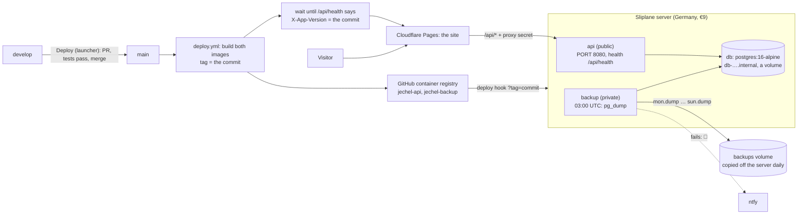

# Deployment

Hosting, the deploy pipeline and setting up the services. Part of the [README](../README.md).

## Deployment

| What | Where | How it gets there |
| ---- | ----- | ----------------- |
| Site (`frontend/dist`) | Cloudflare Pages, on https://jechel.dev | `wrangler pages deploy` in `deploy.yml` |
| `/api/*` on the site | A Pages Function (`frontend/functions/api/[[path]].ts`) | Deployed with the site. Forwards to the API |
| API | Sliplane (Germany), one €9 server (1 vCPU, 1 GB): the image from `backend/Dockerfile` | Built in `deploy.yml`, pushed to the GitHub container registry, run through Sliplane's deploy hook |
| Database | PostgreSQL 16 on the same server, on a Sliplane volume | Migrations run when the API starts (`appsettings.Production.json`) |
| Backups | A third service on the server (`backend/db-backup/`): `pg_dump` every night to a volume Sliplane copies off the server daily | Built and deployed with the API |

**Branches.** Work happens on `develop`. `main` is production: whatever is on `main` is live. `main` only changes
through pull requests whose **Backend** and **Frontend** checks passed (a GitHub ruleset,
`.github/rulesets/main.json`: Settings → Rules → Rulesets → New ruleset → Import a ruleset), and every change to it runs
`.github/workflows/deploy.yml`: the images, then the API (it waits until the new one answers), then the site.

**Deploying:** the launcher's **Deploy to production** (only on `develop`, with everything committed), or
`scripts/deploy.sh`. It pushes `develop`, opens the pull request `develop → main` (or reuses the open one) with
auto-merge on, and waits for the tests; when they pass, GitHub merges and deploys. Needs the GitHub CLI:
`brew install gh && gh auth login`.

**Built on GitHub, run on Sliplane.** The server is small, so it never builds: GitHub Actions builds the images, tags them
with the commit, and calls each service's deploy hook with that tag. The API says which build it is on `/api/health`
(`X-App-Version`, from `APP_VERSION`), and the site is only deployed once the new API answers, so the two never get out of
step. The API runs with one compact garbage-collected heap (`DOTNET_gcServer=0`, `DOTNET_GCConserveMemory`): about
85 MB idle.

**One origin.** The browser only talks to https://jechel.dev. The Pages Function forwards `/api/*` to the API with
three headers: `X-Proxy-Secret` (shared with the API as `Proxy:Secret`), `X-Site-Host` and `X-Client-IP`. With a
secret set, the API answers 404 to anything without it (except `/api/health`, for Sliplane's health check and the deploy),
and takes the host (Google's callback URL) and the visitor's IP (rate limits, analytics) from the proxy
(`ProxyHeaders.cs`). So the auth cookie stays first-party and there's no CORS, as with the Vite proxy locally.

**Data Protection keys** (they encrypt the sign-in cookie and the secrets saved in Settings) are kept in the
database (`data_protection_keys`), so they survive redeploys, encrypted with `DataProtection:KeyEncryptionKey`.

**The proxy also forwards the visitor's country** (`X-Client-Country`, from Cloudflare's `CF-IPCountry`), for analytics and the
sign-in alerts and device list.

### Backups

`backend/db-backup/` is a `postgres:16-alpine` image with two scripts. `backup.sh` dumps the database every night at
`BACKUP_HOUR` (UTC, default 3) with `pg_dump --format=custom` as `<weekday>.dump`: seven files, each night replacing last
week's, so the last seven days are always there. They go into `BACKUP_DIR`, a volume on the server (written next to the
old one and moved into place, so a copy of the folder never holds half a dump), which Sliplane copies off the server
every day and keeps for 7 days. That costs nothing extra; Sliplane's object storage (the `S3_*` settings, uploaded with
`curl --aws-sigv4`) also works, for €5 a month. Sliplane's daily copy of the database's own volume can catch it
mid-write; a finished dump can't be. A failure rings the phone (`NTFY_URL`, `NTFY_TOKEN`), and the service keeps going.
`RUN_NOW=1` takes one as it starts.

**Restoring:** set the backup service's **Override CMD** to `/backup/restore.sh wed` (the day to go back to) and deploy it:
it restores `wed.dump` over the database (`pg_restore --clean --single-transaction`), then waits. Set the CMD back to
empty and deploy again. To go back further than a week, restore an older copy of the backups volume in Sliplane first
(it comes back as a new volume: attach it to the backup service), then run the same. Tried end to end against a
Postgres 16 container, with a volume and with an S3 stand-in (RustFS): dump, change the data, restore, the data is
back; a wrong password rings ntfy with the token.

### Setting up Sliplane (once)

1. **Server:** Create server → Germany → **Starter** (€9).
2. **db:** Deploy service → Registry → `docker.io/library/postgres:16-alpine`, **Expose Service** off, protocol TCP.
   Environment: `POSTGRES_USER=portfolio`, `POSTGRES_DB=portfolio`, `POSTGRES_PASSWORD=` (`openssl rand -hex 24`).
   Volume: add one, mounted at `/var/lib/postgresql/data`, and `PGDATA=/var/lib/postgresql/data/pgdata` (Postgres won't start in a
   folder that isn't empty). The other services reach it at its **Internal endpoint** (e.g. `db-9w4x8w.internal`, port 5432):
   Sliplane adds a suffix to the name.
3. **Images:** run **Deploy** once (or the Deploy workflow by hand) so both images exist, then on GitHub → Packages make
   `jechel-api` and `jechel-backup` **public** (the repository is public anyway), or give Sliplane registry credentials.
4. **api:** Deploy service → Registry → `ghcr.io/claomike/jechel-api:<a commit>`, **Expose Service** on (HTTP), health
   check route `/api/health`, and the environment below. Copy its address (`https://….sliplane.app`) and its
   **Deploy hook** URL.
5. **backup:** Deploy service → Registry → `ghcr.io/claomike/jechel-backup:<a commit>`, **Expose Service** off, a volume
   mounted at `/backups`, and `BACKUP_DIR=/backups`, `POSTGRES_HOST=<the db's internal endpoint>`, `POSTGRES_DB`,
   `POSTGRES_USER`, `POSTGRES_PASSWORD` (as the db's), `NTFY_URL=https://ntfy.sh/<your topic>`. Deploy it once with
   `RUN_NOW=1` to check `Backed up as /backups/<day>.dump` in its logs, then remove it. Copy its **Deploy hook** URL.
6. **GitHub** (Settings → Secrets and variables → Actions): secrets `SLIPLANE_API_DEPLOY_HOOK`,
   `SLIPLANE_BACKUP_DEPLOY_HOOK`, `CLOUDFLARE_API_TOKEN` (permission: Cloudflare Pages, Edit), `CLOUDFLARE_ACCOUNT_ID`;
   variables `API_URL` (the api service's address from step 4) and `CLOUDFLARE_PAGES_PROJECT`.
7. **Cloudflare Pages** (Settings → Variables and secrets, Production): `API_ORIGIN` (the same address) and `PROXY_SECRET`.

### Settings in production

On the **api** service (`__` separates sections):

| Variable | Value |
| -------- | ----- |
| `PORT` | `8080` |
| `ConnectionStrings__Default` | `Host=<the db's internal endpoint>;Port=5432;Database=portfolio;Username=portfolio;Password=<the db's password>` |
| `Proxy__Secret` | A long random string (`openssl rand -hex 32`), the same as the Pages project's `PROXY_SECRET` |
| `Authentication__Google__ClientId` / `__ClientSecret` | The Google OAuth client. Its redirect URI: `https://jechel.dev/api/auth/signin-google` |
| `Auth__AdminEmails__0` | Your Google email |
| `DataProtection__KeyEncryptionKey` | `openssl rand -base64 32`. Keep a copy somewhere safe: without it the stored keys can't be read |
| Anything else from [Configuration](../README.md#configuration) | Or set it in the Settings tab |

**Try the production build locally:** `docker build -f backend/Dockerfile -t jechel-api .` from the repo root, then
`npx wrangler pages dev dist --binding API_ORIGIN=… --binding PROXY_SECRET=…` in `frontend` after `npm run build`.
