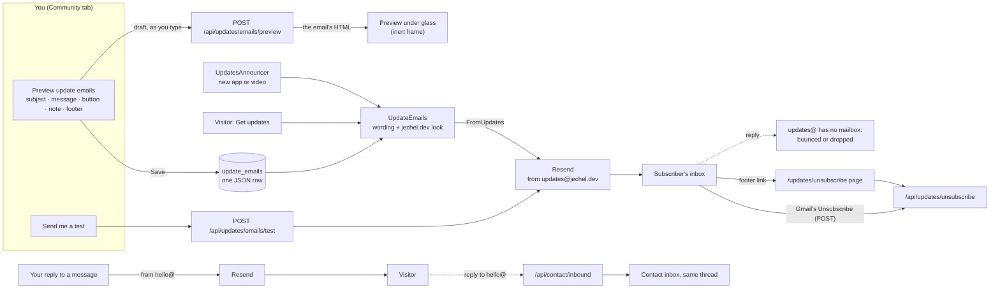
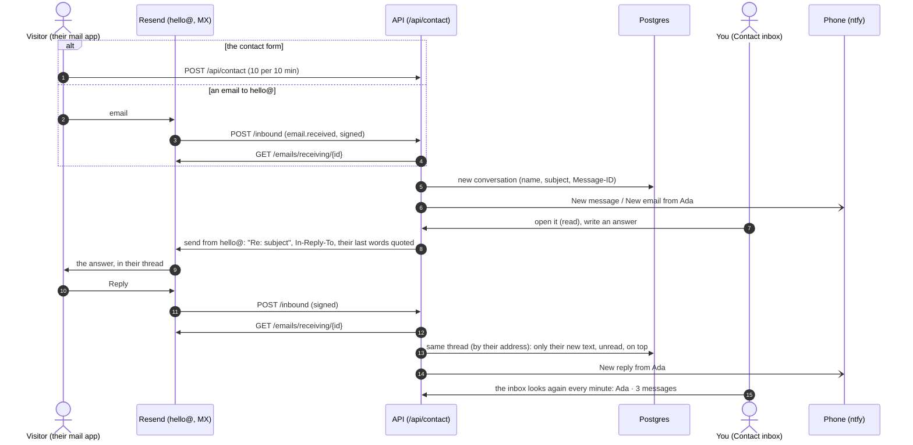
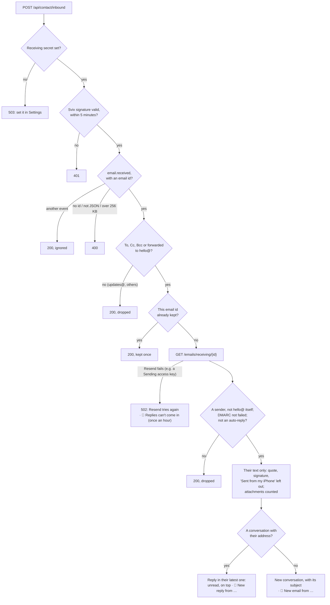
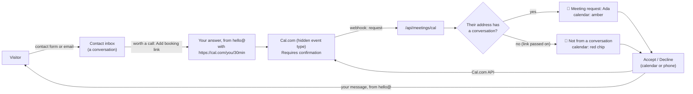

# Features

Each feature end to end: terms, analytics, coffees, update emails, the résumé, conversations and meetings. Part of the [README](../README.md).

## Terms and conditions

```
  The terms (GET /api/terms)
     saved by the admin in the Terms tab ──▶ terms_page (title, intro, sections), dated when saved
     never saved ─────────────────────────▶ TermsDefaults (dated TermsDefaults.UpdatedAt: move it when they change)
          │
          ▼  their date is the version a visitor accepts
  A visitor opens any page (not /admin)
     this browser accepted that version? (localStorage "terms.accepted")
        yes ──▶ the site; visits are recorded (AnalyticsTracker: "on")
        no  ──▶ the welcome popup (TermsGate): one box, Continue
                   the terms can be read above it (TermsDialog)
                   nothing is recorded meanwhile ("waiting"; a visitor who never accepts is never sent)
                   Continue ──▶ the version is remembered ──▶ the site; recording starts
  The signed-in admin: never asked, never recorded.

  Anywhere: the footer's "Terms and Conditions" opens TermsDialog (× / Escape / a click outside close it;
  a link in them to a page of the site goes there and closes it).
  Locally (npm run dev, not signed in): the User bar's "Reset terms acceptance" forgets it and reloads.
```

- **Welcome popup:** a visitor who hasn't accepted the terms (anywhere but the sign-in page, `/admin`) gets a popup that can't be closed: one box, "I have read and I accept the Terms and Conditions of this website", then **Continue**. Everything else is in the terms themselves. Accepting is remembered in the browser (`localStorage["terms.accepted"]`) against the terms' date (`updatedAt`), so new terms ask everyone again. The signed-in admin isn't asked.
- **The default terms** (`backend/.../Features/Terms/TermsContent.cs`, `TermsDefaults`) are shown until the admin saves terms in the Terms tab. They describe, from the code, what the site records and keeps, who handles it and visitors' rights (UK GDPR), and point to the Contact page for requests. They have their own date (`TermsDefaults.UpdatedAt`): **move it whenever their text changes**, so visitors are asked again. Tests check they still name every browser-storage key and outside service (`TermsEndpointsTests`); add to both when the site starts keeping something new. They're a starting point, not legal advice.
- **Reading them:** the footer on every page, and the welcome popup, have a **Terms and Conditions** link that opens them in a popup above anything else that's open. It closes with **×** at the top (or Escape, or a click outside).
- **Seeing the welcome popup again** (to try it): run the site locally (`npm run dev`), not signed in. A **User** bar sits above
  the header (`layout/UserBar`), the visitor's counterpart of the Admin bar, with **Reset terms acceptance**: it forgets this
  browser's acceptance and reloads the page. It shows only in Vite's `development` mode: never on the live site, and not in
  tests unless one switches it on (`vi.stubEnv('MODE', 'development')`).
- **Editing them:** the admin's last tab, **Terms**, shows them as a page with an **Edit** button: title, introduction, and numbered sections of paragraphs and bullet lists (add, reorder, remove). Text may contain `[text](https://…)` links.

## Engagement (visitor analytics)

The site records how it's used itself: no third parties, no cookies. The admin reads it in the **Engagement** tab.

**Recording** (`src/features/analytics/tracker.ts`, mounted by `<AnalyticsTracker>` in `App/App.tsx`):

- **What:** pages opened (with the query); clicks on buttons, links and fields (the label the visitor saw, plus a link's address; **never what was typed**), and clicks into embedded players (YouTube: the window loses focus to the frame); fields changed (`change`: a list's option, a slider's value, how many files; a text field only that it was edited); forms sent (`submit`, with Enter or a button); Escape; copying text (not what); videos played, paused and finished; how far down each page was read (`scroll`, in quarters, recorded on leaving the page); the tab hidden and back (`tab`); leaving (`leave`); the site's own events (`trackEvent`: Terms accepted, Message sent / not sent and why, Contact form invalid with the field left wrong (once per field), Subscribed / again / failed and why, Subscription confirmed, Unsubscribed, Support clicked, Swiped to another slide, Moved to another slide with the keyboard, Zoomed / Moved the map, Looked at a place on the map, Theme changed); and every **error**: script errors with file, line and stack (not a bare "Script error." with no file: that's a script the browser or an extension put in the page, such as Firefox on iPhone's on taps, since the site runs only its own; nor an error at an http(s) page address of this site rather than a script file (a `blob:` script's still counts), nor another site's script or stylesheet that didn't load: the CSP allows neither, so both are the browser's, such as Chrome on iPhone's Translate, whose RangeError is reported at the page and whose gstatic.com stylesheet is blocked), unhandled promise rejections, React crashes with the component stack (`createRoot` callbacks in `main.tsx`), requests that fail with 5xx or no answer (`onRequestFailed` in `api.ts`; 4xx answers are expected and skipped), and images or files that didn't load.
- **A visit** is a browser tab: a random id in `sessionStorage`, so it survives reloads and ends with the tab. It starts with the page, the referring site (host and path; no query), `utm_*` tags, language, time zone, screen and window size, and theme.
- **Theme:** a visit keeps the theme it started in (Vice for first-time visitors, their earlier choice for those coming back) and the one it ended in: every batch says the theme on show, and the last is sent as the tab closes. Each switch is a `Theme changed` event with `from` and `to`.
- **Who isn't recorded:** visitors who haven't accepted the terms (the tracker is off: nothing is kept for later; once they accept, the visit starts with the page on show and `Terms accepted`), the signed-in admin (the tracker waits for the sign-in check, and the API ignores requests with the admin cookie), and bots and headless browsers (by User-Agent, which includes the Playwright runs).
- **Sending:** batches every 5 seconds, and `sendBeacon` when the tab is hidden or closed. Limits: 1,000 events per page load, the same error 5 times, and the API stops a visit at 2,000.
- **Unique visitors without cookies:** the API hashes IP + User-Agent with a random salt that changes every UTC day and is never stored (`VisitorHasher`), like Plausible. The same person counts once a day, can't be followed across days, and no IP is stored. A restart picks a new salt, so someone may count twice that day.

**Storage:** `visit_sessions` (one row per visit, with counters) and `visit_events` (one row per event, `detail` as `jsonb`; unique on visit + sequence number, so a batch sent twice is stored once). Deleting a visit deletes its events, and `AnalyticsRetention` deletes visits after 12 months.

```
 Visitor's browser                                                       API                          Admin
 ─────────────────                                                       ───                          ─────
 Welcome popup ── not accepted ──► tracker OFF (nothing recorded or kept)
       │ accepted (Terms accepted)
       ▼
 tracker ON ◄── <AnalyticsTracker>: pages opened, theme switches, signed-in? (admin ⇒ OFF)
   │ listens: click · change · submit · Escape · copy · play/pause/ended · scroll depth
   │          · tab hidden/back · leave · frame focus (YouTube) · errors · failed requests
   │ trackEvent(): Message sent · Subscribed · Swiped · Zoomed the map · …
   ▼
 queue ──every 5 s──► POST /api/analytics/events ──► Collect: skip admin & bots, dedupe by seq,
   └──tab hidden/closed──► sendBeacon (15 a piece)       date by age, hash IP+UA (daily salt),
                                                         country (CF-IPCountry) ──► visit_sessions
                                                         errors ──► phone alert (throttled)  visit_events
                                                                                    │
 Engagement tab ◄── GET /api/analytics/summary?range= ◄── counters, chart, top lists ┤ (admin only)
   visits table ◄── GET /api/analytics/sessions?errorsOnly= ◄───────────────────────┤
   a visit ◄────── GET /api/analytics/sessions/{id} (timeline, Copy steps) ◄────────┘
                   DELETE …/{id}            AnalyticsRetention: deletes visits after 12 months
```

**The tab** (`src/pages/EngagementPage/EngagementPage.tsx`, `src/features/analytics/`): a period of 1 hour, 1 day, 7 / 30 / 90 days, 1 year, 5 years or all time, with
- counters: visitors, visits, page views, average visit, bounce rate (one page and nothing done on purpose: clicks, keys, changes, forms and site events count; scrolling, the tab and leaving don't; `AnalyticsRules.InteractionTypes`), errors
- visitors, page views or errors as a column chart, one column per 5 minutes (1 hour), hour (1 day), day (7 to 90 days), month (1 and 5 years; all time) or year (all time beyond 6 years). Columns are aligned in UTC (`AnalyticsRange.cs`); "1 hour" and "1 day" are rolling. Visits count when they started, page views and errors when they happened. Hover a column for its number; a hidden table gives screen readers the same
- top pages, where visitors come from, most clicked, **what visitors did** (the site's events, theme changes aside), errors, **preferred theme** (the one visits ended in), **theme switches** ("vice → dark"), devices, browsers, **countries** (Cloudflare's, by name), time zones
- **Refresh** loads the numbers and the visits again, and a visit seen before is asked for again when it's next opened (it may still be going on)
- every visit (optionally only those with errors). One opens its timeline: what it ran on, then each step with its time, errors with their stack. **Copy steps to reproduce** gives it all as text, for an issue or an AI. Visits can be deleted.

Summaries are worked out in memory from the period's rows: plenty for a personal site; move the grouping into SQL if traffic grows a lot.

**Privacy:** nothing is recorded until the visitor has accepted the terms (`AnalyticsTracker` keeps the tracker off, so
not even clicks under the welcome popup are sent later), and the terms say exactly what's recorded: a backend test
(`The_default_terms_say_what_is_recorded`) fails when a kind of event is added without a line in the terms. Visits are deleted 12 months after they were last
seen (`AnalyticsRetention`, daily; `TermsDefaults.VisitRetentionMonths`). IP addresses aren't stored (`VisitorHasher`).

## Buy me a coffee (donations)

The header's amber **Buy me a coffee** button links to the page in `Support:Url` (Settings tab), hidden while it's empty; steam rises from its cup (paused while nobody is using the page, `<html data-idle>`), and on hover the cup fills with coffee, bottom to top (`.coffee-steam`, `.coffee-fill` in `glass.css`). The site
uses **[Buy Me a Coffee](https://buymeacoffee.com/claomike)** (it keeps 5% of each coffee, plus the payment processor's fee).

**Coffee alerts** come from its webhook (`Features/Support/SupportEndpoints.cs`): in the Buy Me a Coffee dashboard add a webhook to
`https://<your-domain>/api/support/buymeacoffee`, and paste its secret into Settings. Each request must be signed (HMAC-SHA256 of the
body with the secret, in hex, in `X-Signature-Sha256`, or `X-Bmc-Signature` as older webhooks did). Each **event on a payment** is
stored once: unique on the event and the payment's id (`donation.created:58`), or a hash of the body, so a retried webhook isn't
stored twice, while a coffee's **refund** or a membership's **change** or **cancellation** (same id, another event) is kept too. Two
deliveries of the same event at once store it once.

- **Each kind of event** gets its own words on the phone and in Community → Coffees: ☕ a coffee (`5 GBP from Jo`, with their note),
  **Refunded**, ⭐ **New member**, **Membership changed** / **cancelled**, 🛍️ an **extra**; anything else is named by its event.
- **Send test** (`live_mode: false`) is stored marked **Test** and alerts quietly, saying no money moved.
- **The note** is the supporter's own (`support_note`), never Buy Me a Coffee's line ("Jo bought you a coffee", in `message`).

```
 Buy Me a Coffee                              API (/api/support/buymeacoffee)                       You
 ───────────────                              ───────────────────────────────                       ───
 a coffee, a refund, a membership     ──►  no secret set? ─► 503 (it retries)
 starting / changing / ending, an           body > 64 KB? ─► 400
 extra, or "Send test" (live_mode false)    HMAC-SHA256(body, secret) ≠ X-Signature-Sha256? ─► 401
 POST, signed; retried until a 200          not a JSON object? ─► 400
                                                  │
                                                  ▼
                                   key = "{event}:{payment id}"  (or SHA-256 of the body)
                                   seen before ─► 200, nothing more   (also two at once: the unique key)
                                                  │ new
                                                  ▼
                                   donations row: event, name, note (support_note only), amount,
                                   currency, email, is_test, the whole body ─────────────────────► Community → Coffees
                                                  │                                                (newest first, paged;
                                                  ▼                                                 "refunded", "Test", …)
                                   phone alert (ntfy): ☕ / Refunded / ⭐ New member / … ──────────► your phone
                                   "Test: …", quietly, for Send test

 Header: GET /api/support ─► the page's link, or "" while Buy me a coffee is off (Settings → Visitor pages) or no link is set
```

Buy Me a Coffee doesn't document its webhook's JSON well, so the API reads the common field names (`supporter_name`, `amount`,
`currency`, `support_note`, `supporter_email`, under `data` or `response`) and keeps the whole body in `donations.payload`. After the
first real webhook, check that payload against these names. Locally, the webhook can't be reached from
Buy Me a Coffee: it needs the site to be online.

## Email updates

Visitors click **Get updates**, give an email address, and confirm it from an email (double opt-in). From then on they get an
email for every new app and YouTube video, with a one-click unsubscribe link (and the `List-Unsubscribe` headers Gmail and Yahoo
require of bulk senders). The button's bell rings once every 10 seconds at rest, in its own colours; on hover (or keyboard
focus) it turns yellow and keeps ringing (`.bell-body`, `.bell-clapper` in `glass.css`; still for reduced motion, and paused
while nobody is using the page, `<html data-idle>`).

- **Subscribing** (`Features/Updates/UpdatesEndpoints.cs`): addresses are stored lower case, with a random 256-bit token used in
  the confirm and unsubscribe links. The confirmation email isn't sent to the same address more than once per 10 minutes, and each
  IP gets 5 tries per 10 minutes (`Updates:SubscribeLimitPer10Minutes`). The popup says whether a confirmation was sent, one is
  already on its way, or the address is already subscribed (this tells anyone whether an address is subscribed: a choice made
  for clarity). Unsubscribing deletes the row. When the email can't be sent, the visitor hears it didn't work and the admin's
  phone gets the email service's reason. Two presses at once with a new address store it once and send one email (the
  second answers "already on its way"). An address that isn't confirmed within **7 days** is deleted (each run of the
  announcer; the terms say so): someone may have typed another person's address.
- **The links** open pages on the site (`/updates/confirm`, `/updates/unsubscribe`, in `pages/UpdatesPages/UpdatesPages.tsx`) that call the
  API, rather than API URLs, so mail scanners that open every link don't confirm anyone.
- **Deleting an app** whose email hasn't gone out (waiting for you, or about to be sent) marks that email not sent, and the
  phone alert's buttons stop working for it.
- **A new app asks first:** adding an app (while Apps and Get updates are on for visitors) records it as `pending` and sends a phone alert with **Send email** and **Ignore** buttons
  (`AnnouncementDecisions.cs`). The buttons post to the API with a one-time token in the link, since the phone isn't signed in (so
  they only work once the site is online; locally, decide in the Community tab, which has the same two buttons).
- **New videos don't ask:** one published after announcing started is approved by itself.
- **Only what visitors can see:** nothing is emailed while **Get updates** is off (approved apps wait until it's on); a new video
  found while the YouTube page (or Get updates) is off is recorded as not sent, so switching it on later doesn't email a backlog;
  a new app isn't offered to email while Apps (or Get updates) is off, and an approved one isn't sent while Apps is hidden. An app's
  email links to the Apps page (What's new? may be hidden, or showing something newer by then).
- **Sending** (`UpdatesAnnouncer.cs`, run every 10 minutes by `UpdatesWorker`, and at once after an approval): emails what's approved,
  reading the app as it is then (edits since are included; a deleted one is skipped). Each item is marked **sending** *before* the
  emails go out, counting them as they go, and **sent** once they have: a crash halfway means some miss it, never that anyone gets it
  twice (who got it is still counted when the API stops mid-send, and the next run marks it sent). The Community tab shows
  "Sending… · 2 sent so far" and asks again every 2 seconds while an email is to be sent or sending, so the final count shows
  without a reload (`SENDING_REFRESH_MS`); with nothing on its way it doesn't ask again. An email the service refuses for one
  subscriber isn't counted, and the rest still go. When *no* email goes out (the email service down or refusing), the item goes back to "to be sent" and is tried
  again next run, and the phone hears why (once an hour); an item is only lost for subscribers whose own email failed. With no
  subscribers yet, an item counts as sent. At most 3 items per run; 600 ms between emails.
- **Email service** (`Email.cs`): [Resend](https://resend.com) (free for 3,000 emails a month), while an API key is set (Settings, or
  `Email:ResendApiKey`); otherwise emails are written to the API's log, confirm links included. The key needs **Full access** once receiving is on
  (the site reads each received email from Resend); a Sending access key sends fine but every reply fails (502, and a phone alert,
  **Replies can't come in**, with Resend's reason, once an hour).
- **Two senders** (Settings → Resend): **Sender** (`Email:From`) for everything, and **Updates sender** (`Email:UpdatesFrom`) for
  subscribers, the confirmations and the updates. Make the updates sender an address with no mailbox (e.g.
  `jechel.dev <updates@jechel.dev>`, with no Cloudflare Email Routing rule for it, or a catch-all
  set to **Drop**): replies to it vanish (the receiving webhook only keeps emails to the main sender's address), and never
  reach you. Your replies to contact messages and the meeting notes go from the main sender, and people's answers to *those*
  come back into the Contact inbox (see [Conversations](#conversations-contact)). Without an updates sender, subscribers get
  emails from the main one.
- **Setting up Resend:** add and verify your domain in Resend (Domains: a DKIM `TXT` record, two `CNAME`s for sending, set to
  **DNS only** in Cloudflare, and optionally `_dmarc`), then set the senders in Settings and press **Send me a test email**. Until
  then the sender is `jechel.dev <onboarding@resend.dev>`, which Resend only delivers to the Resend account's own address.
- **Receiving** (Settings → Resend → Receiving email): in Resend's Domains turn on **Receiving** and add its `MX` record in
  **Cloudflare** (DNS → Records, name `@`; the domain's DNS is there, not at Porkbun, so a record added at Porkbun does nothing);
  in Webhooks add `/api/contact/inbound` for `email.received`, and paste its signing secret in Settings. The API key must have
  **Full access** (a Sending access one can't read received emails). Check it with
  `dig +short MX jechel.dev`: empty means mail to hello@ goes nowhere (the sender gets a bounce, often days later).
- **The wording** (Community → **Preview update emails**, `features/updates/UpdateEmailsEditor/`, API in
  `UpdateEmailsEndpoints.cs`): the same four fields for each email (the confirmation, a new video, a new app): **Subject**,
  **Message**, **Button** and **Note** (optional, in grey under the button), plus the footer (why they get it; that replies aren't
  read, with a link to the contact page). A new item's subject and message can hold `{title}`; the longer texts take paragraphs
  and `[text](url)` links (http(s), or a path on the site). The card opens on the preview alone, made by the API with the same
  code that sends the emails, about your newest app or video; **Edit** brings up the fields beside it, and the preview follows
  them as you type. **Save** (only once something changed) keeps the changes to all three emails; **Cancel** throws them away;
  either goes back to the preview. The preview sits under glass: the frame is `inert` and as tall as the email,
  so nothing in it can be clicked, focused or scrolled. **Send me a test** emails the draft to you, marked `[Test]`, from the
  updates sender; when your address is subscribed, its links carry your own code, so its Unsubscribe really unsubscribes you.
  Otherwise they carry the code `test`, and the pages say the link is from a test and change nothing. Every email gets its own
  `X-Entity-Ref-ID` header, so Gmail never stacks a test under the real email of the same subject (where the old button is easy to press).
  Saved as one JSON row (`update_emails`); saving the defaults unchanged deletes it, so improved defaults reach the emails too.
  (Wording saved when a new item still had a one-line heading reads that heading as its message.)
- **Unsubscribing:** the link in the footer opens the site's page (`/updates/unsubscribe`), which calls the API; the
  `List-Unsubscribe` header that Gmail's own **Unsubscribe** button uses points straight at the API (`/api/updates/unsubscribe`),
  since one-click unsubscribing is a `POST` (RFC 8058) and a static page can't take one. Mail apps that *open* that link
  instead (a `GET`) are sent on to the page, which unsubscribes; a `GET` itself changes nothing.
- **The look** (`UpdateEmails.cs`): a dark header with the site's icon and the name in pink and violet, the sunset stripe, a white
  card, and a pink-to-violet button. The icon (`email-icon.png`, 96 px) travels *inside* each email as an inline attachment
  (`cid:jechel-icon`): Gmail fetches linked pictures through its own servers, which can't reach a site that isn't online (such as
  `localhost`). The preview writes it into the page as a `data:` URL instead, since browsers can't read `cid:`. Email apps drop
  much of CSS (Gmail ignores gradients on text), so it's plain inline styles, every gradient on a solid colour of its own, and a
  light colour scheme so dark-mode mail apps don't invert it.

**A subscriber, and an update email, from start to end:**

```
 Visitor                          Subscriber row                              Update email (announcements)
 ───────                          ──────────────                              ────────────────────────────
 Get updates ─► address ─► unconfirmed ──(7 days, never confirmed)──► deleted   new app ─► pending ──Ignore──► not sent
   (twice at once: stored once)  │  confirmation email (updates@, no replies)      │ Send email (here or the phone)
                                 │  again only after 10 minutes                    ▼
 the email's button ───────────► confirmed ─► 📱 New subscriber               new video ─► to be sent
                                 │                                                 │ every 10 min, or at once after Send
 Unsubscribe (link, or the       │                                                 ▼
 mail app's own button: POST;    ▼                                             sending ─► each confirmed subscriber
 a GET goes to the page) ─────► deleted                                            │
                                                                                   ├─ some went out ─► sent (count kept,
                                                                                   │                   also if stopped halfway)
                                                                                   └─ none went out ─► to be sent again
                                                                                                       + 📱 "Emails aren't going out"
 Deleting an app whose email waits ─► that email: not sent (its phone buttons stop working)
```



- **Privacy:** the default terms say what's stored (the address, its code, when it was confirmed) and that unsubscribing deletes it.

## Résumé generator

Signed in, About Me starts with a **Résumé generator** panel (`features/resume/ResumePanel/ResumePanel.tsx`), which visitors never see. The
résumé is the only one the site offers: there's no upload any more.

- **The header** (headline, email, **phone**) is edited with **Photo and links**, in a "For the résumé" group. It's saved on its
  own (`PUT /api/resume/contact`), never in the About Me JSON. The **headline** is public: About Me shows it under the name
  (`GET /api/resume/headline`, which returns nothing else), and a save shows the new one at once (the store takes it from the
  save's answer). The **email and phone** are only shown to the admin, under the links, each with a copy button.
- **The panel** chooses the **sections** (ticked by default: citizenship, links, experience, skills, education, qualifications,
  papers, hackathons, languages; not ticked: problem solving, licences, places) and the **skills** (all until unticked; stored as
  the ones left out, so new skills are in). Sections print in a fixed order recruiters expect.
- The name, contact line and links are on the **first page only**; there are no page numbers. Links show as words: the site's
  name, **GitHub**, **LinkedIn**. Skills are a plain list, without years.
- **Generate résumés** makes two A4 PDFs from the page as it is now (`Features/Resume/ResumeDocument.cs`, with
  [QuestPDF](https://www.questpdf.com), free under its Community licence for individuals and companies under $1M revenue):
  - **public**, without the email and phone number (so the email isn't harvested for spam): stored, and served to everyone at `/api/resume`. The page's **Download résumé** button
    is pointed at it (`/api/resume?v=<time>`, so browsers fetch the new one), replacing an uploaded PDF if there was one.
  - **private**, with the email and phone number: stored, and only served to the admin (`/api/resume/private`, `no-store`).
  Then **Download private copy** and **Download public copy** in the panel.
- The email and phone number live in their own table (`resume`), never in the About Me JSON, so they can't leak through `/api/about`. Tests check
  they're in the private PDF's text and not in the public one's.
- `[text](url)` links on the page become real links in the PDF.

## Conversations (contact)

Everything happens by email, through the site's address (the **Sender** in Settings → Resend, e.g. `hello@jechel.dev`), never your
own. A message sent through the contact form, or an email to that address, starts a **conversation** in the inbox (Contact, signed
in). You answer from there; the answer goes from hello@, so when they reply from their mail app, Resend receives it and the
site puts it in the same thread, unread again and on top, and your phone hears it (**New reply from …**; **New email from …** for
someone new; kind *New message* in Notifications). Text only: what they quoted is left out, attachments are only counted
("1 attachment, not shown: it's in Resend").

- **Receiving** (`InboundEmail.cs`): Resend's **Receiving** on the domain (an `MX` record; jechel.dev has no other mail), and a
  webhook for `email.received` to `/api/contact/inbound`, signed the Svix way (`svix-id`, `svix-timestamp`, `svix-signature`;
  older than 5 minutes is refused). The webhook only says which email came; the site reads it from Resend
  (`GET /emails/receiving/{id}`, `ResendInbox`).
- **Which conversation:** the sender's latest one, by address (any case); someone new starts one, named after the email's
  display name, with its subject. Each email is taken once (`email_id`, unique), however often Resend reports it.
- **Dropped:** emails to any other address (replies to updates@ go nowhere), failing DMARC, sent by a program (`Auto-Submitted`,
  `Precedence: bulk`: out-of-office answers, bounces), from the site's own address, or with no sender.
- **Threads in their mail app:** your answer is "Re: " their subject (or "Re: your message to jechel.dev"), with `In-Reply-To`
  their latest email's `Message-ID`, and quotes what they wrote last.
- **Before receiving is set up** (no signing secret in Settings), answers carry your own address as `Reply-To`, so replies
  still reach you, in your own inbox.
- **Limits:** the contact form allows 10 messages every 10 minutes per address (`Contact:LimitPer10Minutes`).
- **Deleting** a conversation (from the inbox) deletes every message in it.
- **Live:** the inbox, and a conversation that's open, look again every minute (an email can come in at any time); sending an
  answer reloads the inbox, so the conversation moves up with one more message.

```
 Visitor                                   API                                         You (admin)
 ───────                                   ───                                         ───────────
 Contact form ── POST /api/contact ───────► conversation: first message                ──► 📱 New message from Ada
   (10 per 10 min, per address)              unread, on top of the inbox                    Contact → inbox
 or ✉️ to hello@ ─► Resend ─► webhook ─────► (someone new: their name and subject)   ──► 📱 New email from Ada
                                                                                              │ open: read; answer
 ✉️ "Re: …" from hello@ ◄─────────────────── email (Resend): your answer, what they  ◄── POST …/messages/{id}/reply
    (in their thread)                         wrote last quoted, In-Reply-To
          │ they press Reply in their mail app
          ▼
 ✉️ to hello@ ──► Resend (MX) ──► POST /api/contact/inbound (signed)
                                  GET /emails/receiving/{id}
                                  to hello@? DMARC ok? a person? new?
                                  ──► the same thread, their text only,  ──────────────► 📱 New reply from Ada
                                      unread again, on top                                  inbox: "Ada · 3 messages"
                                                                                              │ answer again
 ✉️ the next answer, same thread ◄───────────────────────────────────────────────────────────┘
```

How one conversation goes, end to end:



What happens to each email Resend reports (`InboundEmail.Receive`):



## Meetings (Cal.com), by invitation, and replies

**Meetings are by invitation only.** Visitors get the contact form alone: no booking page on the site, and the Cal.com event type is
**Hidden**, so it isn't on your public Cal.com profile either. When a conversation is worth a call, press **Add booking link** in the
reply box (shown once a Cal.com page is set in Settings): it adds the link (`/api/meetings/info`, admin only) under what you wrote,
and it goes in your answer, from hello@. A request from an address with no conversation (the link was passed on, or found) is
marked **Not from a conversation**: in the calendar, and first in the phone alert (also on a booking that needed no confirmation),
so it's quick to decline.



**You decide:** with **Requires confirmation** on the Cal.com event type, a booking is a *request*:
- your phone gets **Meeting request: Grace** with **Accept** / **Decline** buttons (a one-time token in their links)
- the Contact tab has a **Meetings** calendar above the messages: the month with each day's meetings marked (amber waiting,
  green accepted), and the chosen day's meetings, each request with **Accept** / **Decline** and an optional message
- a message from someone who also booked shows that meeting in its popup, with the same buttons

Accepting or declining goes through Cal.com's API (`/v2/bookings/{uid}/confirm` or `/decline`, `cal-api-version: 2026-02-25`),
so Cal.com sends its usual emails and calendar invites; your message, if any, is emailed too (Resend, from the site's address,
so their answer lands in the Contact inbox; for a decline it's also Cal.com's reason). Cal.com's webhook (`/api/meetings/cal`) keeps each booking up to date: requested,
created, rescheduled (the old one is marked cancelled), cancelled, rejected.

**Cancelling:** an accepted meeting that hasn't ended has **Cancel meeting** (in the calendar, and in the message's popup). It
asks first ("Cancel the meeting with Grace?", **Keep it** / **Cancel meeting**), with an optional reason, then cancels through
Cal.com's API (`/v2/bookings/{uid}/cancel`, `POST /api/meetings/{id}/cancel`, admin only): Cal.com emails them (with the reason)
and frees the time in your calendar. Cal.com refuses a host's cancel without a reason, so with none it's given "The meeting was
cancelled by the organiser." The meeting is marked cancelled *before* Cal.com is asked, because Cal.com's webhook can arrive
before its answer does: it finds the meeting cancelled already, so there's no phone alert for what you just did. If Cal.com
refuses or can't be reached, the meeting is put back to accepted and the popup says why (stays open); Accept and Decline also
answer 502 "Cal.com couldn't be reached." on a network failure, instead of crashing.

**Reminders** for accepted meetings go to your phone a day before, 2 hours before, 5 minutes before and when it starts
(`MeetingReminders`, checked every 30 seconds by the site itself; ntfy only keeps scheduled messages for 3 days). If a reminder's
time passed while a later one is due (a meeting accepted an hour before), only the latest goes out. Times in alerts use
`Site:TimeZone` (default Europe/London).

**Replies:** a message's popup has a reply box: the answer is emailed to the sender with their message quoted, and kept with the
message; their answer comes back into the same thread (see [Conversations](#conversations-contact)). Until a domain is verified
in Resend, it only reaches your own address.

**Setting up Cal.com** (Settings → Cal.com has the links and the URL to paste):
1. An event type (e.g. 30 minutes) with your availability, **Hidden** on (only people you send the link can book), and
   **Advanced → Requires confirmation** on. Its link goes in Settings. Also worth setting there: booker email verification,
   booking limits (e.g. 2 a week), a minimum notice and how far ahead people can book.
2. Connect your calendar in Cal.com (Google, Outlook…) so busy times are blocked and accepted meetings land in it.
3. **Settings → Developer → Webhooks:** `https://<your-domain>/api/meetings/cal`, a secret (also in Settings), and the booking
   events: requested, created, rescheduled, cancelled, rejected. Cal.com can't reach `localhost`, so this needs the site online.
4. **Settings → Developer → API keys:** a key, pasted in Settings, so this site can accept and decline for you
   (**Check the API key** tests it).
